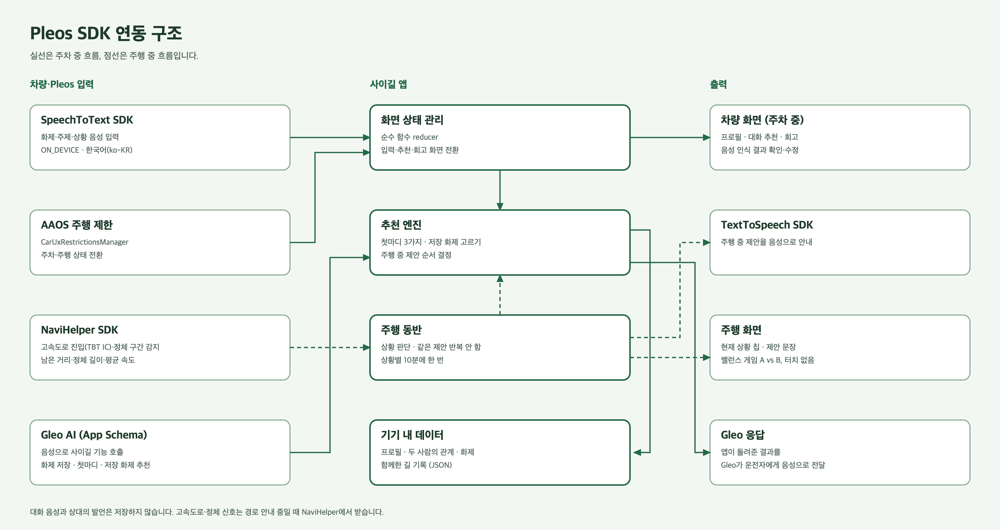
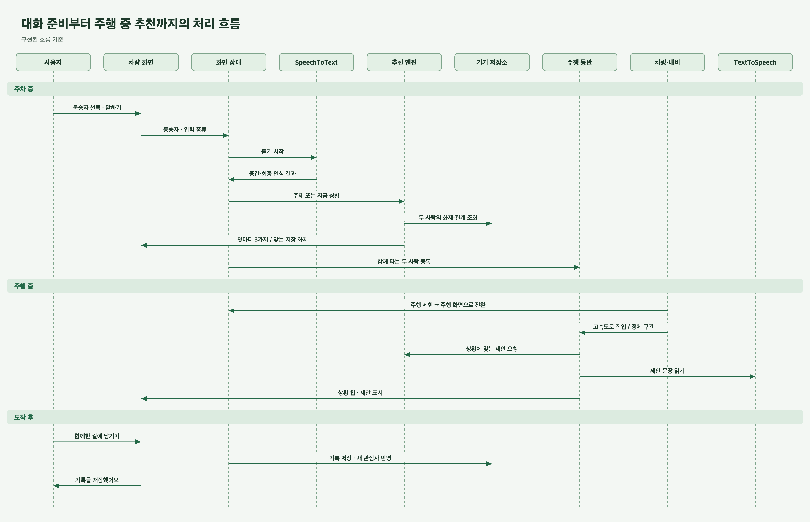

# 5. 개발 계획

사이길은 Pleos Connect의 Android Automotive OS 환경에서 실행되는 차량용 앱입니다. Kotlin과 Jetpack Compose로 화면을 만들었고, Pleos SpeechToText·TextToSpeech·NaviHelper SDK와 Android Automotive의 주행 제한 API, Gleo AI 연동(App Schema)을 사용합니다. 현재 Pleos Connect Emulator v2.1.0에서 다섯 가지 사용 시나리오가 모두 동작합니다.

## [ 주요 개발 범위 ]

**1) 프로필과 관계 데이터**

누구든 같은 방식으로 프로필(이름, 자주 가는 곳, 관심사)을 등록합니다. 앱을 열 때마다 "나는 누구인가요?"에서 현재 사용자를 고르고, 화제는 특정 프로필이 아니라 나와 동승자 두 사람의 관계에 저장합니다. 두 사람의 관계(부모·자녀 등)는 처음 한 번만 묻고, 이에 따라 첫마디의 존댓말과 반말을 정합니다.

**2) 음성 입력과 대화 추천**

추천 모드에서 동승자를 고른 뒤 "하고 싶은 이야기가 있어요"를 고르면, 말한 주제를 풀어가는 서로 다른 접근 3가지(질문하기, 내 경험 나누기, 함께 기뻐하기, 경청하기 중)를 첫마디와 이어 가는 방법으로 보여 줍니다. "무슨 이야기를 할지 모르겠어요"를 고르면 지금 상황을 말하고, 두 사람에게 저장된 화제 중 상황에 맞는 것을 골라 줍니다.

**3) 주행 상황에 맞춘 능동 추천**

출발 전 동승자를 고르면 주행 중 음성 추천이 켜집니다. 고속도로 진입이나 정체 구간을 감지하면 저장한 화제, 요즘 화제, 밸런스 게임 중 하나를 음성으로 제안하고, 주행 화면에 현재 상황과 제안 내용을 크게 보여 줍니다. 정체 구간에서는 가벼운 밸런스 게임을 먼저 제안하며, 같은 주행에서 같은 제안을 반복하지 않고 상황별로 10분에 한 번만 말합니다.

**4) 함께한 길에 남기기**

도착 후 대화가 원활했는지와 새로 발견한 관심사를 남기면, 관심사는 동승자 프로필에 더해지고 대화 흐름은 다음 추천의 접근 순서에 반영됩니다. 관계 데이터는 따로 저장하지 않고 함께한 길 기록에서 계산해, 기록과 어긋나지 않게 했습니다.

**5) 주행 안전**

주행이 시작되면 모든 입력 화면을 닫고, 터치와 애니메이션이 없는 주행 화면으로 바꿉니다. 주차하면 하던 화면으로 돌아갑니다.

## [ SDK·API 활용 ]

**1) SpeechToText SDK 3.3.1**

화제, 주제, 상황을 음성으로 입력받습니다. ON_DEVICE 모드와 한국어(ko-KR)를 사용해 별도 서버 등록 없이 차량 안에서 인식하며, 중간 결과를 화면에 보여 주고 최종 결과는 사용자가 고칠 수 있습니다. 인식이 어려우면 키보드로 입력할 수 있습니다.

**2) TextToSpeech SDK 3.3.1**

주행 중 능동 추천 문장을 차량 스피커로 읽어 줍니다.

**3) NaviHelper SDK 3.0.5**

`onTBTInfo`의 고속도로 진입 안내(`TURN_ENTER_IC`)로 긴 주행을, `RouteStateInfo`의 혼잡 구간 정보로 정체를 감지합니다. 남은 거리, 정체 구간 길이와 평균 속도를 주행 화면에 표시합니다.

**4) CarUxRestrictionsManager (Android Automotive)**

주행 제한 상태를 받아 입력 화면과 주행 화면을 전환합니다. 상태를 확인할 수 없을 때도 입력을 막습니다. 앱은 Distraction Optimized로 선언해, 주행 중에는 사이길이 직접 그리는 조작 없는 주행 화면만 보여 줍니다.

**5) Gleo AI 연동 (App Schema)**

`schema.json`에 세 가지 기능을 등록해, 운전 중 "글레오, 사이길에서 엄마랑 할 얘기 추천해 줘"처럼 말로 사이길을 부를 수 있게 합니다. 화제 저장(SAVE_TOPIC), 첫마디 추천(RECOMMEND_OPENER), 저장 화제 추천(RECOMMEND_SAVED_TOPIC)이며, 앱이 결과를 돌려주면 Gleo가 운전자에게 음성으로 전달합니다.

## [ 모듈 구성 및 통신 ]

[그림 4] Pleos SDK 연동 구조

화면 상태는 순수 함수 reducer로 관리하고, 저장·음성 인식·차량 연동은 그 결과로만 실행합니다. 데이터(프로필·관계·화제·함께한 길), 추천 엔진, 화면 상태, 음성 입력, 주행 동반, Gleo 연동을 각각의 모듈로 나눴습니다. 가족 데이터는 기기 안에만 JSON으로 저장하며, 대화 음성과 상대의 발언은 수집하지 않습니다.

[그림 5] 대화 준비부터 주행 중 추천까지의 처리 흐름

## [ 개발 현황과 남은 계획 ]

- 구현 완료. 다섯 가지 시나리오, 음성 입력, 주행 중 음성 추천과 주행 화면, Gleo 기능 등록.
- 2차 발표까지. 예상 이동 시간을 추천에 반영, 기록 삭제와 개인화 초기화, Gleo 음성 호출의 호출어 인식 안정화, 세로 화면 대응.

## [ 검증 ]

추천 엔진과 화면 흐름은 단위 테스트 43개로 확인합니다. Pleos Connect Emulator에서 Virtual Console로 기어를 바꿔 주행 화면 전환을 확인했고, 에뮬레이터가 경로 주행을 재현하지 못하는 고속도로·정체 상황은 시연용 신호로 검증했습니다.
