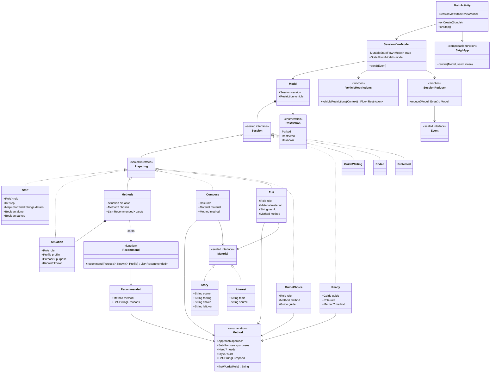
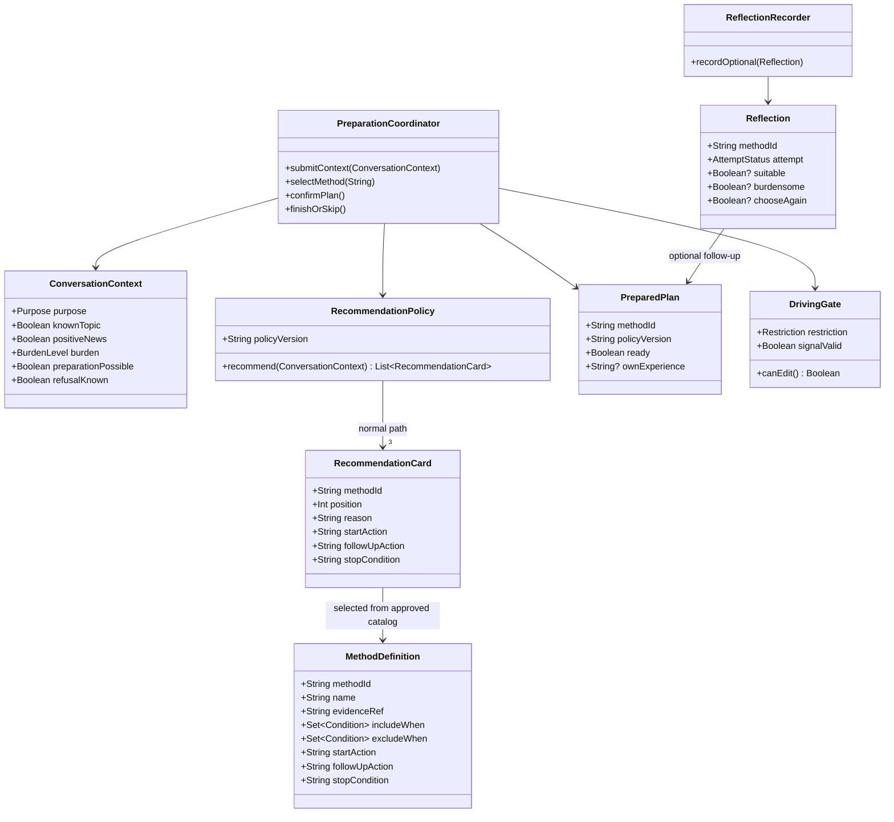

# 사이길 클래스 다이어그램

기준: 2026-11-14 · 상태: 현재 코드와 최종 기획의 차이 명시

이 문서는 현재 Android 프로젝트의 클래스 관계와 최종 기획의 목표 클래스를 **별도 도식**으로 나타낸다. 두 도식 사이에 이름이 비슷해도 구현 완료를 뜻하지 않는다.

## 1. 현재 구현

`VehicleRestrictions`·`SessionReducer`·`Recommend`·`SaigilApp`은 Kotlin **최상위 함수**를 도식용 상자로 표시한 것이며 실제 클래스가 아니다. `Session` 하위 형식은 각각 화면 상태다. `SessionViewModel`은 메모리 `StateFlow`를 보유하고 `vehicleRestrictions()`가 AAOS `CarUxRestrictionsManager`에서 받은 상태를 `Event.VehicleChanged`로 전달한다. `SaigilApp`이 화면 상태에 따라 Compose 화면을 선택한다. `Preparing`을 구현한 화면은 중단·페이지 숨김·주차가 아닌 차량 상태에서 `Protected`로 바뀐다. 방법 카탈로그는 `session/Methods.kt`의 `Method` enum 하나이고, `recommend()`가 W09 선택과 W01 동승자 정보(`Profile`)에서 서로 다른 방법 3장을 고른다. 카드는 `Methods.cards`에서 매번 계산하며 저장하지 않는다. 현재 앱에는 회고 저장소, 선호 학습, NaviHelper 호출이 없다.

## 2. 최종 기획 목표 모델 — 일부 구현

기획의 정상 경로는 `ConversationContext`로 승인된 `MethodDefinition`의 포함·제외 조건을 평가해 **서로 다른 methodId의 카드 3개**를 만든다. 적합한 방법이 3개 미만이거나 거절·준비 불가가 알려지면 보류한다. 카드 선택만으로 `PreparedPlan.ready`가 되지 않고 사용자의 준비 완료 동작이 필요하다. `ownExperience`는 ‘내 경험 나누기’ 방법에서만 선택 입력이다. `Reflection`은 선택적이며 상대의 발화 원문을 저장하지 않는다. `DrivingGate`는 제한·신호 미확인일 때 편집을 막는다. 세부 인터페이스 이름과 필드는 구현 제안이며 확정 API가 아니다.

## 차이와 구현 경계

| 최종 기획 | 현재 코드 | 다음 구현 때 바뀔 부분 |
|---|---|---|
| 짧은 맥락 선택 | `Situation`의 목적·소재 종류와 `Profile` | 부담·거절 여부는 아직 없음 |
| 승인 방법에서 서로 다른 카드 3개 | `Method` 카탈로그와 `recommend()` | 제외 규칙·정책 버전·근거 출처는 아직 없음 |
| 하나 선택 후 행동 안내·준비 완료 | `Methods`에서 고르고 `Ready`가 첫마디·이어 가기·멈춤 안내 표시. 내 경험 나누기는 `Compose`·`Edit`·`GuideChoice`를 거침 | 카드 선택과 `plan_ready` 분리는 아직 없음 |
| 주행 중 선택·입력 제한 | `Restriction`·`vehicleRestrictions()`·`Protected` | 실제 Pleos 전환 지연·지역별 제한·연결 손실 검증 필요 |
| 도착 후 선택 회고 | 없음 | 선택적 회고와 연구 동의별 분석 분리 필요 |

현재 프로토타입을 최종 추천 기능의 완성으로 설명하지 않는다. 자료의 ‘NaviHelper’는 선택형 안내의 경로 맥락 후보이며 이 앱이 자체 길 안내 앱이라는 뜻은 아니다. 데이터베이스와 LLM 클래스는 현재 코드나 확정 범위에 없으므로 도식에 넣지 않았다.

## 근거

- 최종 기획: `제출할 서류/05_validation_upgrade/02_앱프로젝트소개_심사자료_상세기획서.md`의 3장 F1~F5, 5장 구현 전략.
- 현재 코드: `session/Session.kt`, `session/Methods.kt`, `SessionViewModel.kt`, `vehicle/VehicleRestrictions.kt`, `MainActivity.kt`, `ui/Screens.kt`.
