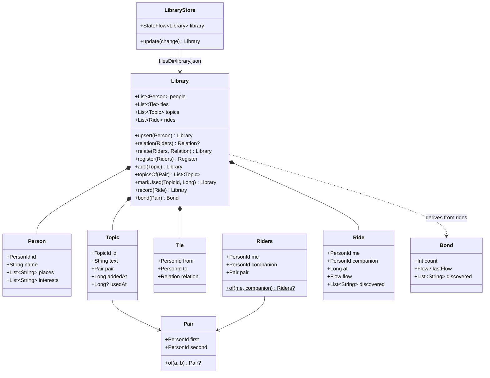
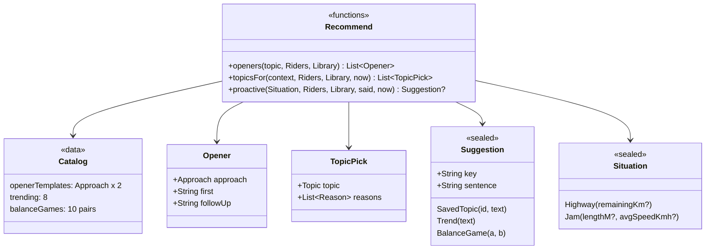
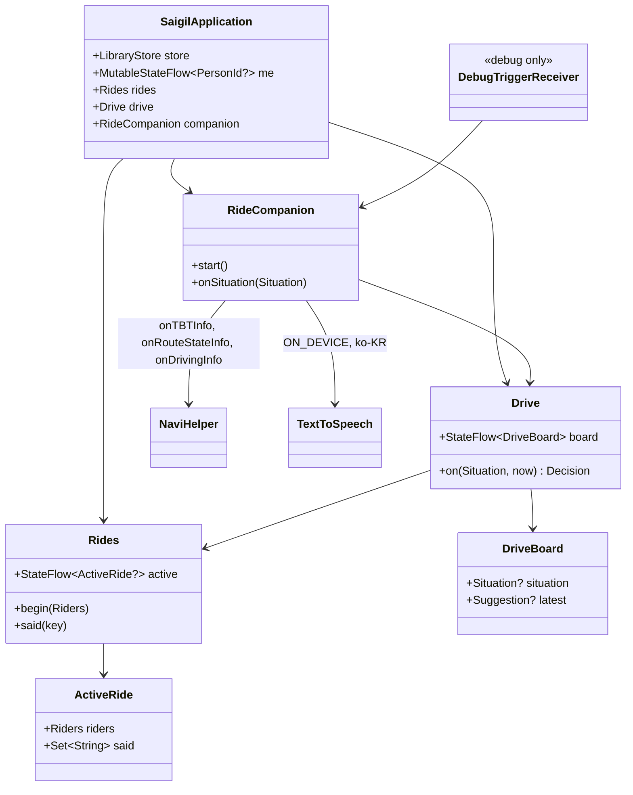

# 사이길 클래스 다이어그램

기준: 2026-11-15 · 설계: [`scenario-v2-design.md`](./scenario-v2-design.md)

v2 시나리오(프로필·화제 저장, 대화 추천, 능동 음성 추천, Gleo 호출, 함께한 길) 구현의 클래스 관계입니다. 이전 `Session`·`Method` 구조는 삭제했습니다.

## 1. 저장 데이터 (`library/`)



- `Pair`는 정렬된 두 사람이라 (a,b)와 (b,a)가 같고, 같은 사람으로는 만들 수 없습니다(`of`가 null, 파일에서 읽을 때도 거부). `Riders`는 같은 쌍에 방향(me, companion)을 더한 것이고 저장하지 않습니다.
- `relate`는 `Tie` 두 개를 함께 바꿉니다. `Parent`의 반대는 `Child`이고 나머지는 대칭입니다.
- `register`는 me→companion이 `Parent`면 `Formal`(존댓말), 그 외나 관계가 없으면 `Casual`(반말)입니다.
- 관계 데이터(`Bond`)는 저장하지 않고 `Ride` 목록에서 매번 계산합니다.
- `LibraryStore.update`는 임시 파일에 쓴 뒤 rename하고, 쓰기가 끝난 다음에 `StateFlow` 값을 바꿉니다.

## 2. 추천 엔진 (`recommend/`, 순수 Kotlin)



- `topicsFor`와 `proactive`는 `Riders.pair`의 화제만 봅니다. `topicsFor`는 한글 글자 bigram 겹침(맥락 x3), 동승자 관심사·장소 겹침(+1), 3일 안에 쓴 화제(-2)로 점수를 냅니다.
- `proactive`는 `Highway`면 저장 화제 → 요즘 이야깃거리 → 밸런스 게임, `Jam`이면 밸런스 게임 → 저장 화제 → 요즘 이야깃거리 순서이고, `said`에 있는 key는 건너뜁니다. 소리 내어 말하는 문장은 `Situation.lead`와 `Suggestion.sentence`를 이어 붙입니다.

## 3. 화면 (`screen/`, `ui/`)

```mermaid
classDiagram
    class SaigilViewModel {
        +StateFlow~Ui~ ui
        +send(Event)
    }
    class Model {
        +Screen screen
        +Restriction vehicle
    }
    class reduce {
        <<function>>
        (Model, Event, Library, me, Stamp) Next
    }
    class Next {
        +Model model
        +List~Effect~ effects
    }
    class Screen {
        <<sealed>>
        WhoAmI, Home, People, PersonEdit
        PickCompanion, TopicCapture, ChooseInput, Listen
        Openers, SavedTopics, Reflect
    }
    class Effect {
        <<sealed>>
        Write: PutPerson, AddTopic, UseTopic, RecordRide, Relate
        BecomeMe, BeginRide, StartListening, StopListening
    }
    class SpeechInput {
        <<interface>>
        +start(onHeard)
        +stop()
        +release()
    }
    class PleosSpeechInput
    SaigilViewModel --> reduce
    reduce --> Next
    Next --> Model
    Next --> Effect
    Model --> Screen
    SaigilViewModel --> SpeechInput
    PleosSpeechInput ..|> SpeechInput
    SaigilViewModel --> LibraryStore : Effect.Write
    SaigilViewModel --> Rides : Effect.BeginRide
    SaigilViewModel --> SaigilApplication : Effect.BecomeMe sets me
```

- 화면 모델은 `WhoAmI`에서 시작합니다. reducer는 지금의 나(`me`)를 인자로 받고, 나를 바꿀 때는 `Effect.BecomeMe`를 돌려줍니다. ViewModel이 새로 만들어지면 `SaigilApplication.me`를 비웁니다.

- reducer는 순수 함수입니다. 시각과 새 id는 `Stamp`로 받고, 저장·음성 인식·active ride는 `Effect`로 돌려줍니다.
- `TopicCapture`와 `Listen`은 `Capture(stt, text)`를 가집니다. `stt`는 `Idle | Listening(partial) | Failed(reason)`이고, 전사 결과는 `text`에 들어가 사용자가 고칠 수 있습니다.
- 주행 제한(`Restriction.Restricted`)이면 UI는 어느 화면이든 주행 보드(`DriveBoard`)를 그리고, reducer는 입력 이벤트를 무시하며 듣기를 멈춥니다. 주차하면 원래 화면으로 돌아옵니다.

## 4. 주행 중 능동 추천 (`drive/`)



- `highwayFrom`: 첫 TBT가 `TURN_ENTER_IC_*`이고 500 m 이내면 `Highway`. `jamFrom`: `SLOW`·`HEAVY` 정체가 300 m 이내면 `Jam`.
- `Drive.on`은 먼저 보드의 상황을 바꾸고, active ride가 없으면 `NoRide`, 같은 종류를 10분 안에 말했으면 `CoolingDown`입니다. 말하면 `latest`를 바꿉니다.
- active ride는 프로세스 메모리에만 있습니다. 첫 `BeginRide` 때 NaviHelper와 TTS를 연결합니다.

## 5. Gleo AI (`gleo/`)

```mermaid
classDiagram
    class GleoReceiver {
        +onReceive(Context, Intent)
    }
    class answer {
        <<function>>
        (Function, params, Library, me, ActiveRide?, Stamp) Answer
    }
    class Answer {
        +Status status
        +String message
        +JsonArray? data
        +Effect.Write? write
    }
    class Function {
        <<enum>>
        RECOMMEND_OPENER
        RECOMMEND_SAVED_TOPIC
        SAVE_TOPIC
    }
    GleoReceiver --> answer
    answer --> Answer
    GleoReceiver --> LibraryStore : Answer.write
    GleoReceiver ..> APP_ACTION_RESPONSE : broadcast within 6 s
```

- 함수 선언은 `app/src/main/assets/schema.json`에 있습니다. 나는 `SaigilApplication.me`입니다. `companion`이 없으면 같은 나의 active ride 동승자를 쓰고, 나를 모르거나 동승자를 정할 수 없으면 `asking`으로 되묻습니다. `SAVE_TOPIC`은 Pair(me, companion)에 저장합니다.
