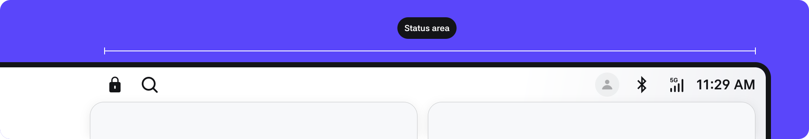
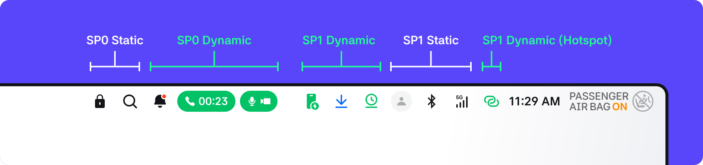
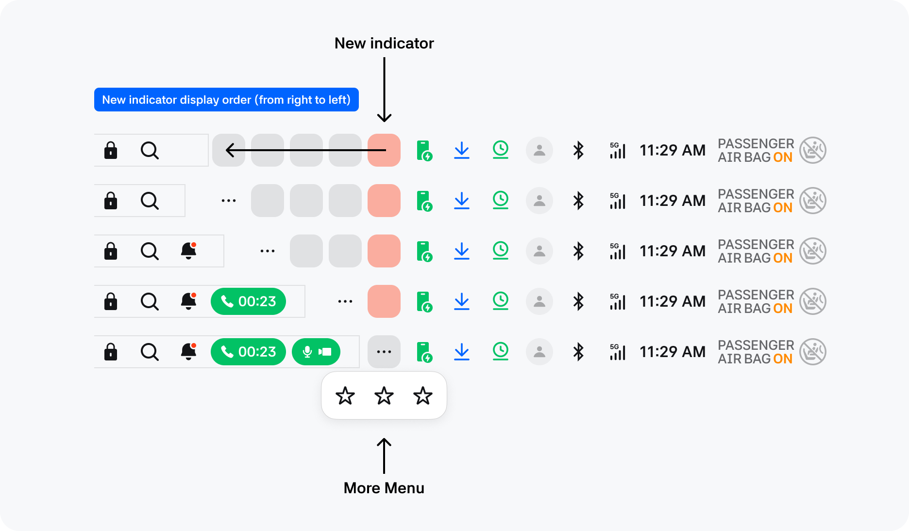
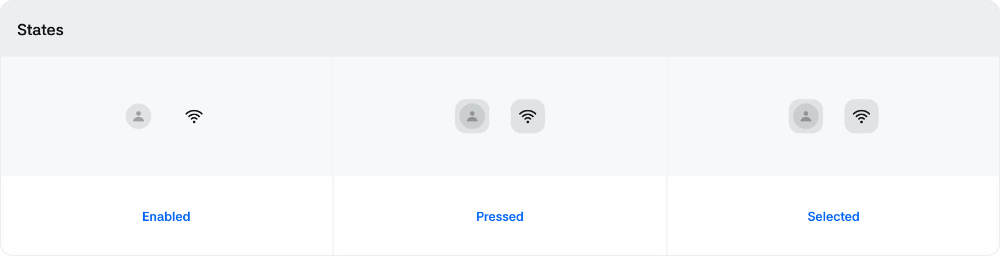
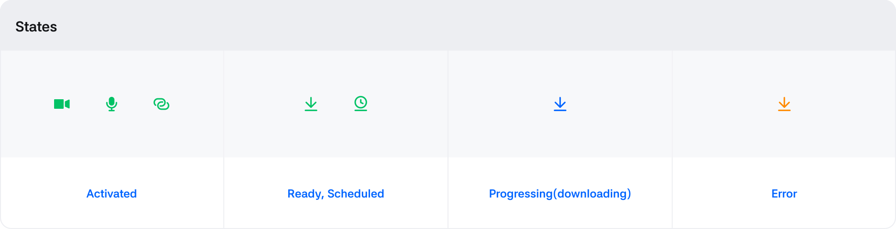
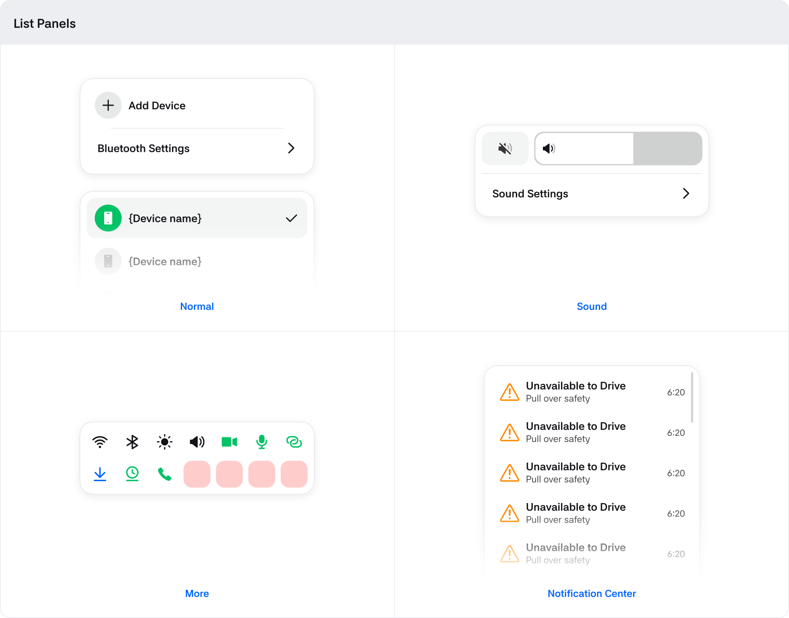

<!-- 원문: https://document.pleos.ai/docs/connect/guide/docs-design/components/status-bar -->
<!-- 가져온 날짜: 2026-11-12. 원문이 바뀌었을 수 있으니 중요한 결정 전에는 원문을 확인할 것. -->

# Status bar

#### Status bar는 차량 내 주행 및 주요 시스템 상태를 인지할 수 있는 영역입니다.

 

---

## Anatomy

**1. SP0 Static** : 우선순위가 높으며, 항상 보여야 하는 고정 버튼 또는 상태를 표시합니다. Door Lock, Search 상태가 표시됩니다.   **2. SP0 Dynamic** : 우선순위가 높으며, 메뉴 중에 이벤트에 따라 발생하는 버튼 또는 상태를 표시합니다. Notification center, In-call status, privacy indicator가 표시됩니다.   **3. SP1 Dynamic** : 우선순위가 낮으며, 메뉴 중에 이벤트에 따라 발생하는 버튼 또는 상태를 표시합니다. Download, Update, WPC, Hi-Pass, Sound 상태가 표시됩니다.   **3-1. SP1 Dynamic Hotspot 버튼** : Hotspot 버튼은 네트워크 관련성이 높으므로 SP1 Static > network 우측에 배치됩니다.   **4. SP1 Static** : 우선순위가 낮으며, 항상 보여야 하는 고정 버튼 또는 상태를 표시합니다. Profile, bluetooth, network 상태가 표시됩니다.   **5. Time** : 실시간 시간을 시스템 설정에 따라 24h 혹은 12h로 표시합니다.   **6. PAB** : 보조석 에어백 활성 상태를 표시합니다. 단, 차량 하드웨어에 PAB 표시가 없을 때에만 IVI에 표시합니다.   **7. More Menu** : 영역 내 표시할 수 없는 더 많은 icon을 표시합니다.  

> **정보**
>
> - SP0과 SP1 영역의 시각적 구분을 위해, 40dp의 safe bounds를 right padding으로 포함합니다.
> - SP1 dynamic indicator 표시 영역이 부족할 경우, more 메뉴로 이동합니다.
> - SP0 dynamic indicator가 늘어날 경우, SP1 dynamic indicator 영역이 줄어듭니다.

 

---

## Menu states

### Static icon

| State | Value | Default Value | Description |
|---|---|---|---|
| Pressed | Boolean | False | 터치로 클릭 중인 상태일 때 True로 전환 |
| Selected | Boolean | False | 활성화 된 경우 True으로 전환 |

### Dynamic icon

| State | Value | Default Value | Description |
|---|---|---|---|
| Activate | Boolean | False | Static indicator의 왼편에 발생 순서대로 표시됨 |

 

---

## Menu panels

상태 메뉴를 클릭하여 앱 서비스 제공에 필요한 부가 기능(장치 연결, 프로필 변경, 알림 등)을 제공할 수 있습니다.

| States | Value | Default Value | Description |
|---|---|---|---|
| Pressed | Boolean | False | 터치로 클릭 중인 상태일 때 True로 전환 |
| Selected | Boolean | False | 활성화 된 경우 True으로 전환 |

 
