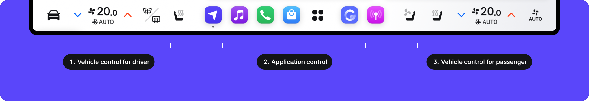
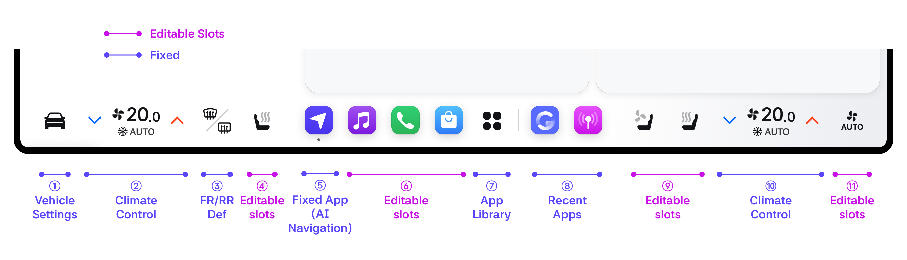
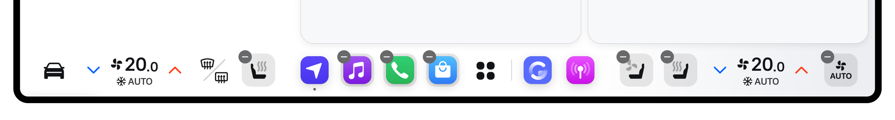
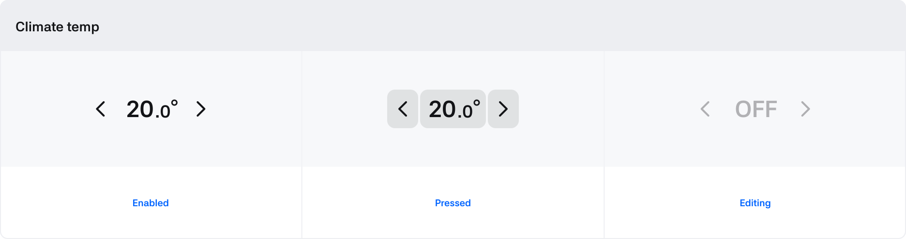
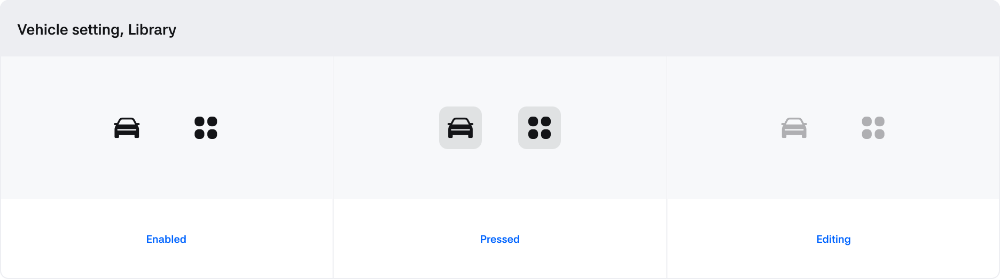
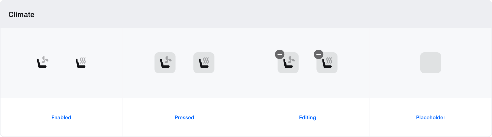
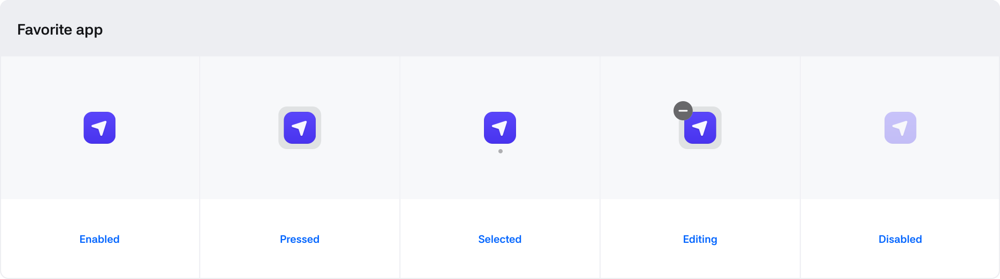
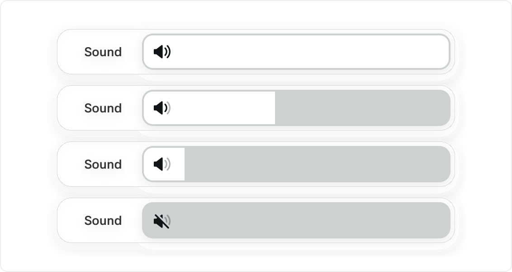
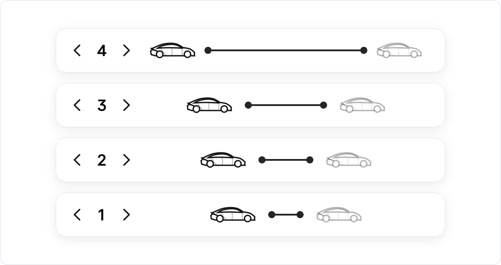

<!-- 원문: https://document.pleos.ai/docs/connect/guide/docs-design/components/gnb -->
<!-- 가져온 날짜: 2026-11-12. 원문이 바뀌었을 수 있으니 중요한 결정 전에는 원문을 확인할 것. -->

# Global Navigation Bar(GNB)

#### Global Navigation Bar(GNB)는 Pleos Connect 이용에 필요한 필수 기능을 빠르게 실행하기 위한 영역입니다.

**1. Vehicle control for driver** : 운전석 및 보조석의 공조 제어 영역   **2. Application control** : 차량 내 설치된 앱 조작 영역   **3. Vehicle control for passenger** : 조수석 공조 제어 영역

 

---

## Control area

**1. Vehicle settings** : Vehicle settings 이동 (편집 불가)   **2. Climate control** : 이 영역을 탭하면 Climate panel이 표시되며, 같은 영역을 다시 탭하면 Climate panel이 닫힙니다.   **3. FR/RR Def** : FR/RR Def가 토글로 동작합니다. 터치 시 미니 팝업이 표시되며, 미니 팝업을 통한 FR/RR 개별 제어가 가능합니다.   **4. Editable slots** : 운전자가 원하는 앱을 이 위치에 두도록 편집할 수 있습니다. 운전석 시트 열선 (또는 시트 통풍) 앱으로 디폴트 구성되어 있습니다.   **5. Fixed app** : Navigation으로 고정되어 있습니다. Center 영역 내 위치 이동은 가능합니다.   **6. Editable slots** : 운전자가 원하는 앱을 최대 3개까지 등록할 수 있는 영역입니다. 앱 또는 Climate shortcut을 등록할 수 있습니다. 디폴트 구성은 Bluetooth Music, Phone, App Market 앱입니다.   **7. App library** : 아이콘을 터치 시 App library panel이 표시됩니다. App library panel이 열린 상태에서 동일 영역 터치 시 panel이 닫힙니다.   **8. Recent apps** : 최근 실행 앱 2개가 표시됩니다. 최신 앱이 왼쪽에 표시됩니다. Editable slots에 있는 앱은 recent apps로 표시되지 않습니다.   **9. Editable slots** : 보조석 탑승자가 원하는 앱을 이 위치에 두도록 편집할 수 있습니다. 디폴트 구성은 보조석 시트 통풍 앱, 보조석 시트 열선 앱입니다.   **10. Climate control** : 운전석 Climate control과 동일하게 동작합니다.   **11. Editable slots** : 보조석 탑승자가 원하는 앱을 이 위치에 두도록 편집할 수 있습니다. 디폴트 구성은 Auto 앱입니다.  

 

---

## GNB 편집

### 편집모드 진입 방법

- GNB에서 진입하기: Editable slots 영역을 long-press 합니다.
- App library에서 진입하기: App library의 climate shortcut 또는 app icon을 long-press 합니다.

### GNB의 편집 가능 영역

- Editable slots로 정의된 모든 영역에 climate shortcut 또는 app icon을 배치할 수 있습니다.
- Fixed app은 삭제 불가하지만 위치는 변경 가능합니다.
- Fixed app을 지원하지 않는 사양의 경우, Editable slots 1개가 확장됩니다.
- Recent apps 영역은 편집할 수 없습니다.

### App library 편집 가이드

- Climate shortcut 영역: 이동만 가능하고 삭제 불가합니다.

    - 아이콘을 끌어 GNB로 이동시킬 수 있습니다.
    - GNB에 이미 배치된 shortcut은 uneditable 상태로 표시되며, 선택할 수 없습니다.
- App 영역: 삭제 및 이동 가능합니다.

    - 삭제 아이콘을 눌러 앱을 삭제할 수 있습니다.
    - 앱을 끌어 GNB로 이동시킬 수 있습니다.

 

---

## States

### GNB menus

   

 

---

## On Screen Display(OSD)

#### 차량 스티어링 휠에 있는 버튼 조작을 통해 차량 제어 및 앱 제어를 할 때 나타나는 패널입니다.

- OSD 패널은 물리키 조작을 통해 IVI의 기능을 동작시킬 때 바뀐 상태를 표시합니다.
- Connect-S에서는 GNB 영역에 표시되고, Connect-W에서는 GNB 우측에 표시됩니다.
- OSD 패널이 나타나고 나서 추가적인 조작이 없을 경우 2초 후에 자동으로 사라집니다,

 

### Case 1. Media & Sound control

운전자가 음악 또는 사운드를 조절 시 보조석에서 쉽게 음악 선곡이나 음량 조작 가능합니다.

 (원격 이미지: 3 MB라 로컬에 저장하지 않음) 

 

### Case 2. Vehicle control

Wiper, Light, Seat Position 등 제어 시 빠른 단계 조절 또는 부가 기능을 조작 가능합니다.

  

 

### Case 3. Distance control

주행 중 앞차와의 간격을 조절 가능합니다.

 
