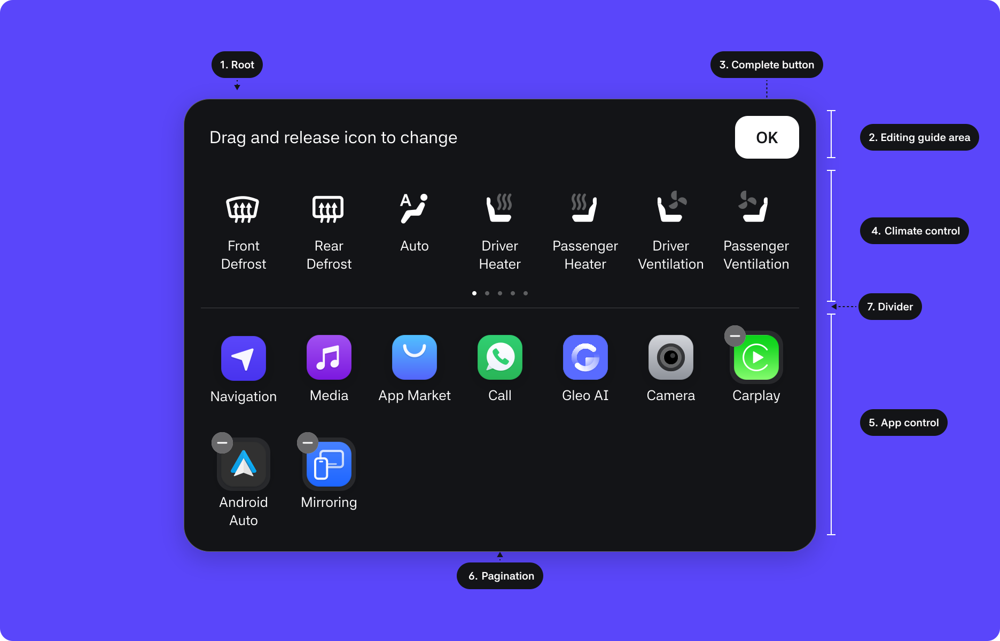
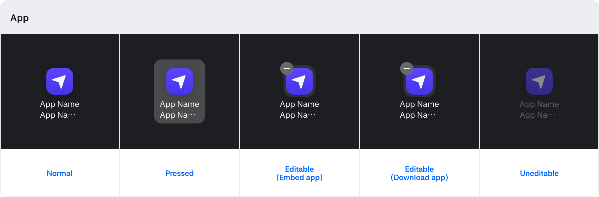
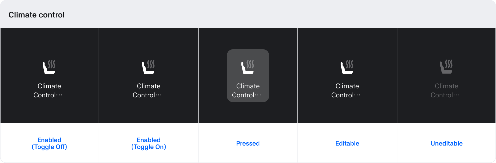
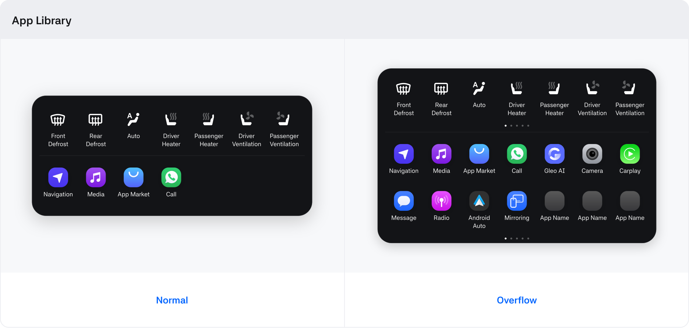
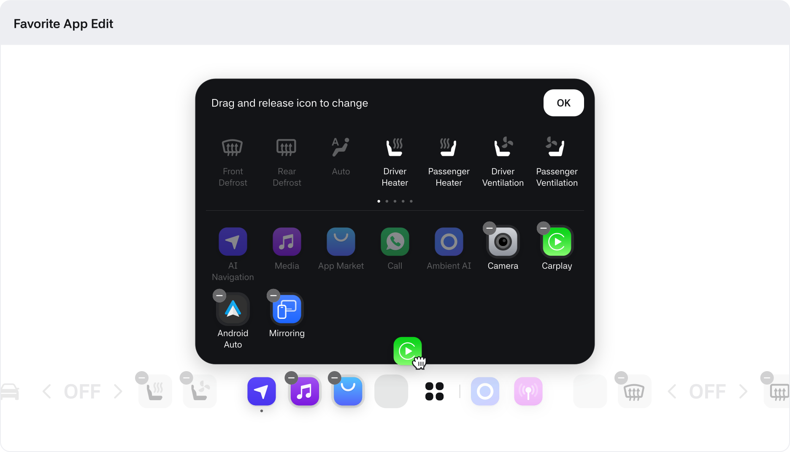
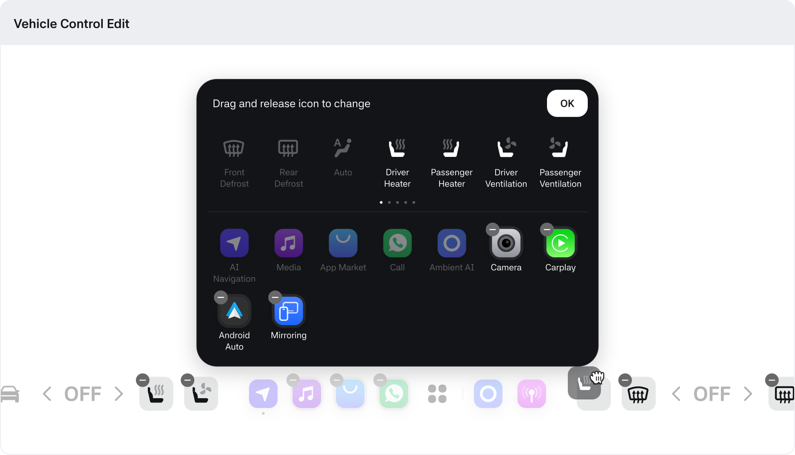

<!-- 원문: https://document.pleos.ai/docs/connect/guide/docs-design/components/app-library -->
<!-- 가져온 날짜: 2026-11-12. 원문이 바뀌었을 수 있으니 중요한 결정 전에는 원문을 확인할 것. -->

# App library

#### App library는 고객이 앱 마켓을 통해 설치한 다양한 앱 서비스가 모여있는 영역입니다.

**1. Root** : 컴포넌트를 감싸는 최상위 컨테이너 영역   **2. Editing guide** : Editing mode에서 표시   **3. Complete button** : Control button 및 App 순서 변경 및 삭제 후 수정 내용을 저장   **4. Climate control** : Heat, ventilation 등 공조 컨트롤 버튼 영역   **5. App** : Embed, download app 영역   **6. Pagination** : 페이지당 Climate control 및 App 노출 가능 수가 넘어가는 경우 표시   **7. Divider** : Climate과 App 영역을 구분합니다.

 

---

## States

 

 

---

## Behaviors

### Normal

- Connect-S를 기준으로 1줄에 최대 7개까지 제공할 수 있습니다.
- Connect-S를 기준으로 2줄 이상 넘어가게 되면 좌/우 이동이 가능한 인디케이터가 표시됩니다.
- 상단 메뉴는 차량 제어, 하단 메뉴는 앱 실행을 위한 메뉴로 구성됩니다.

 

### Editing

 

- 기본 앱이나 GNB에 존재하여 이동할 수 없는 앱들은 비활성화됩니다.
- 차량 제어 메뉴와 앱은 각각 지정된 영역으로만 이동이 가능합니다.
- Drag를 통해 각 영역의 메뉴를 제어할 때 이동할 수 없는 영역은 비활성화됩니다.
- 각 국가의 법규에 따라 Frost와 Defrost는 GNB에 필수 제공될 수 있습니다.
