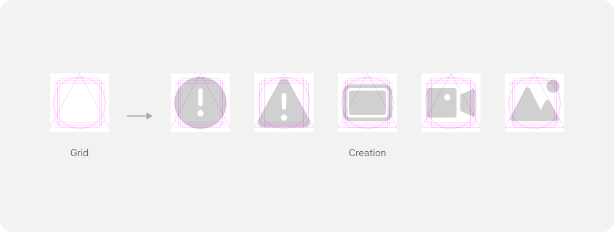
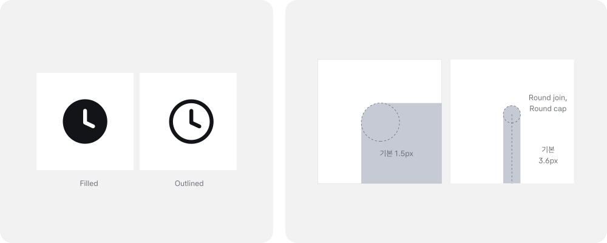
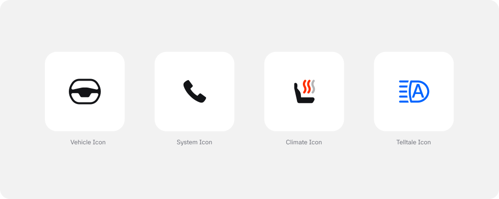

<!-- 원문: https://document.pleos.ai/docs/connect/guide/docs-design/foundations/contents-creation/iconography -->
<!-- 가져온 날짜: 2026-11-12. 원문이 바뀌었을 수 있으니 중요한 결정 전에는 원문을 확인할 것. -->

# Iconography

#### 아이콘은 누구나 직관적으로 인지할 수 있어야 합니다.  

## Creation guideline

**1. Grid system** : 기본 사이즈(48 x 48dp)를 기준으로 작성된 그리드 시스템으로 제작합니다.   **2. Style** : 시인성 확보를 위해 상황에 따라 Filled/Outlined 2가지 타입으로 사용할 수 있습니다.   **3. Variant** : 1벌을 제작 후 필요한 사이즈로 조정하여 디자인을 합니다.

 

## Icon Types

