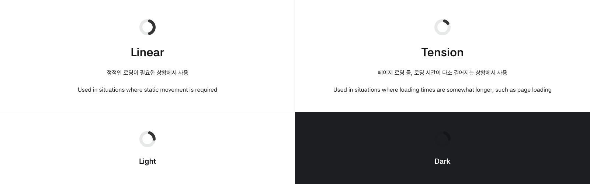

<!-- 원문: https://document.pleos.ai/docs/connect/guide/docs-design/foundations/animation -->
<!-- 가져온 날짜: 2026-11-12. 원문이 바뀌었을 수 있으니 중요한 결정 전에는 원문을 확인할 것. -->

# Animation

사용자에게 상태 설명을 위한 목적에서 animation이 사용됩니다.

[Download Link](https://document.pleos.ai/assets/files/Loading-a564bf9ddfbe2fa3c9640ec7708d9e1d.zip)  

 

## Properties

| Options | Description |
|---|---|
| Linear | 정적인 로딩이 필요한 상황에서 사용 |
| Tension | 페이지 로딩 등 로딩 시간이 다소 길어지는 상황에서 사용 |
