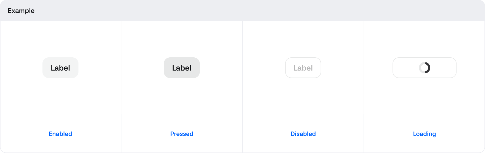
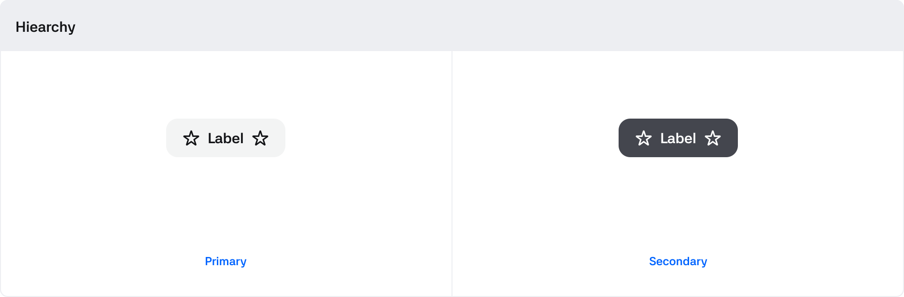
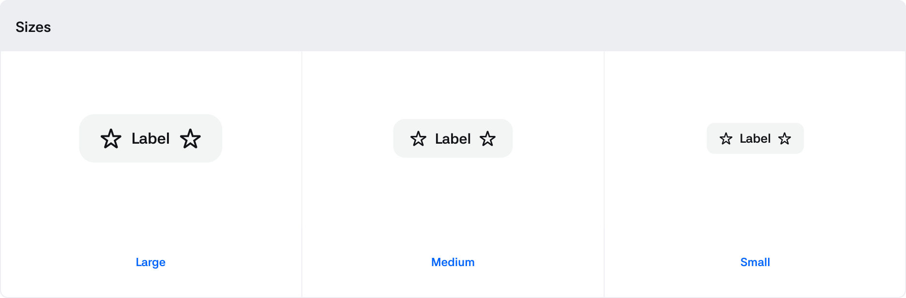

<!-- 원문: https://document.pleos.ai/docs/connect/guide/docs-design/components/actions/basic-button -->
<!-- 가져온 날짜: 2026-11-12. 원문이 바뀌었을 수 있으니 중요한 결정 전에는 원문을 확인할 것. -->

# Basic button

#### 가장 기본적인 버튼으로 명확한 영역과 텍스트를 통해 고객의 행동을 유도할 수 있습니다.

**1. Root** : 버튼을 감싸는 최상위 컨테이너 영역   **2. Label** : 버튼 레이블   **3. Icon**(Prefix) : Label에 대한 시각적 부연설명을 하는 아이콘 영역   **4. Icon**(Suffix) : Label에 대한 시각적 부연설명을 하는 아이콘 영역

 

---

## States

| State | Value | Description |
|---|---|---|
| Pressed | Boolean | 터치로 클릭 중인 상태일 때 True로 전환 |
| Disabled | Boolean | True일 경우, Button이 제어불가능한 상태 |
| Loading | Boolean | True일 경우, Button내 Loader가 표시되고 제어불가한 상태가 됨 |

 

---

## Properties

| State | Value | Description |
|---|---|---|
| Pressed | Boolean | 터치로 클릭 중인 상태일 때 True로 전환 |
| Disabled | Boolean | True일 경우, Button이 제어불가능한 상태 |
| Loading | Boolean | True일 경우, Button내 Loader가 표시되고 제어불가한 상태가 됨 |

  

 
