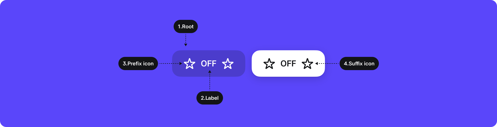
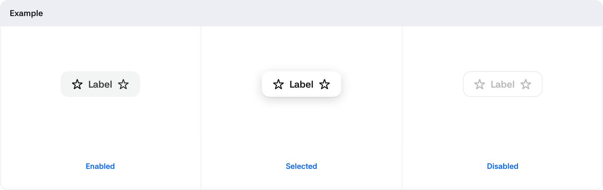
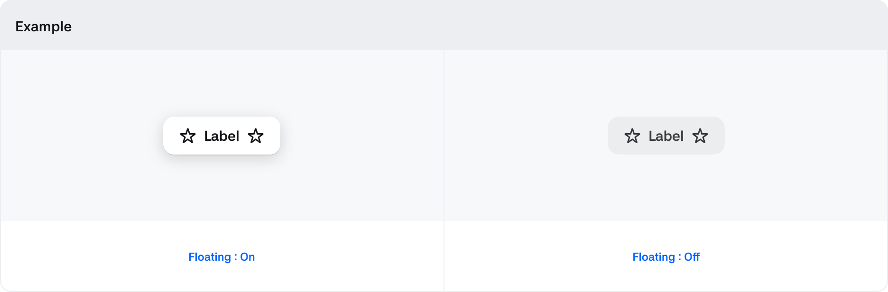

<!-- 원문: https://document.pleos.ai/docs/connect/guide/docs-design/components/actions/toggle-button -->
<!-- 가져온 날짜: 2026-11-12. 원문이 바뀌었을 수 있으니 중요한 결정 전에는 원문을 확인할 것. -->

# Toggle button

#### On/Off 가 가능한 버튼으로 다중 옵션을 제공해야하는 경우 상태 인지에 유용한 버튼입니다.

 

**1. Root** : 버튼을 감싸는 최상위 컨테이너 영역   **2. Label** : 버튼 레이블   **3. Icon**(Prefix) : Label에 대한 시각적 부연설명을 하는 아이콘 영역   **4. Icon**(Suffix) : Label에 대한 시각적 부연설명을 하는 아이콘 영역  

---

## States

| State | Value | Default | Description |
|---|---|---|---|
| Toggled | Boolean | False | Toggle button이 활성화 된 경우 True으로 전환. Default 값은 False |
| Pressed | Boolean | False | Drag 가능한 window일 때 True로 전환 |
| Disabled | Boolean | - | True일 경우, Button이 제어 불가능한 상태 |

 

---

## Properties

| State | Value | Description |
|---|---|---|
| Floating | Boolean | 배경 스타일에 따라 Shadow 또는 컬로로 표현됩니다. |
| Size | Large, Medium, Small | Button의 사이즈 옵션을 선택하여 사용할 수 있습니다. |

 
