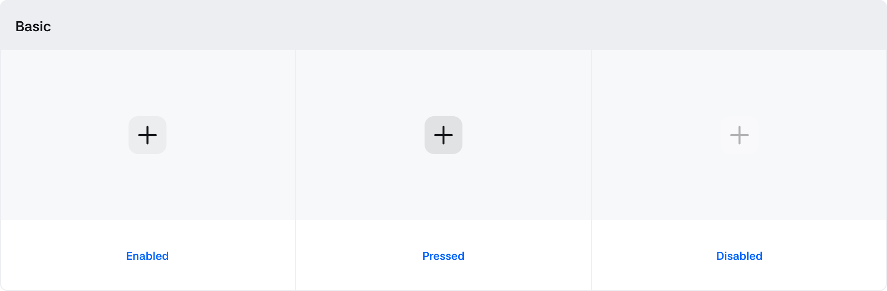
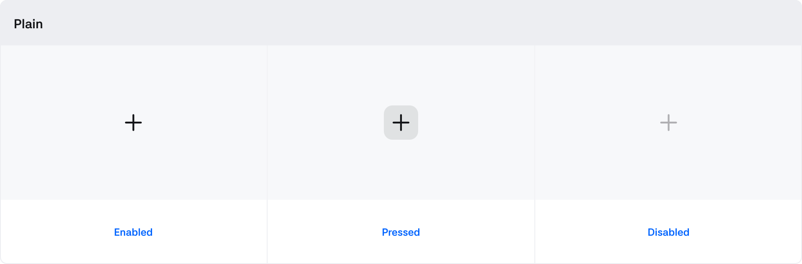

<!-- 원문: https://document.pleos.ai/docs/connect/guide/docs-design/components/actions/icon-button -->
<!-- 가져온 날짜: 2026-11-12. 원문이 바뀌었을 수 있으니 중요한 결정 전에는 원문을 확인할 것. -->

# Icon button

#### 아이콘 버튼은 어떤 고객이든 직관적으로 인지할 수 있는 경우에 사용합니다.

 

**1. Root** : 버튼을 감싸는 최상위 컨테이너 영역   **2. Icon** : 아이콘을 통한 버튼의 정보를 제공하는 영역  

---

## States

| State | Value | Default | Description |
|---|---|---|---|
| Pressed | Boolean | False | Drag 가능한 window일 때 True로 전환 |
| Disabled | Boolean | - | True일 경우, Button이 제어 불가능한 상태 |

 

---

## Properties

| State | Value | Description |
|---|---|---|
| Style | Basic, Plain, Circle | Button의 스타일을 선택할 수 있습니다. |
| Size | Large, Medium, Small | Button의 사이즈 옵션을 선택하여 사용할 수 있습니다. |

      

 
