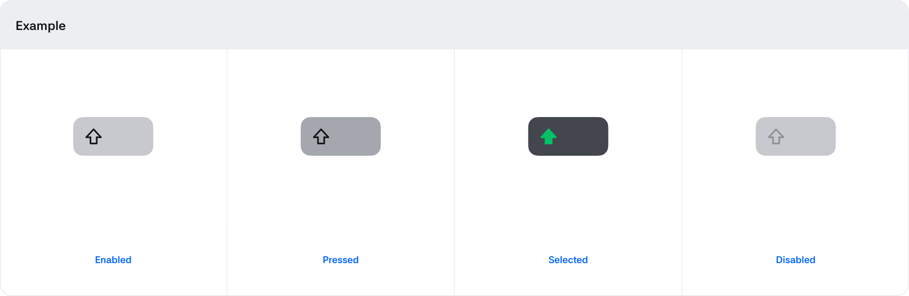
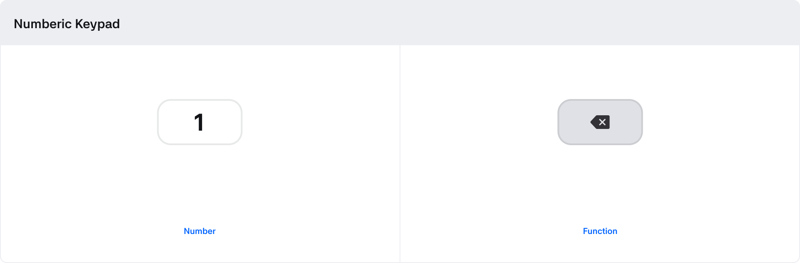
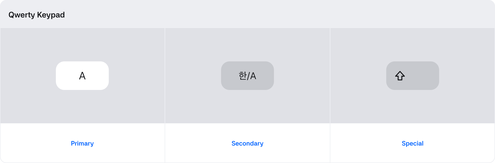
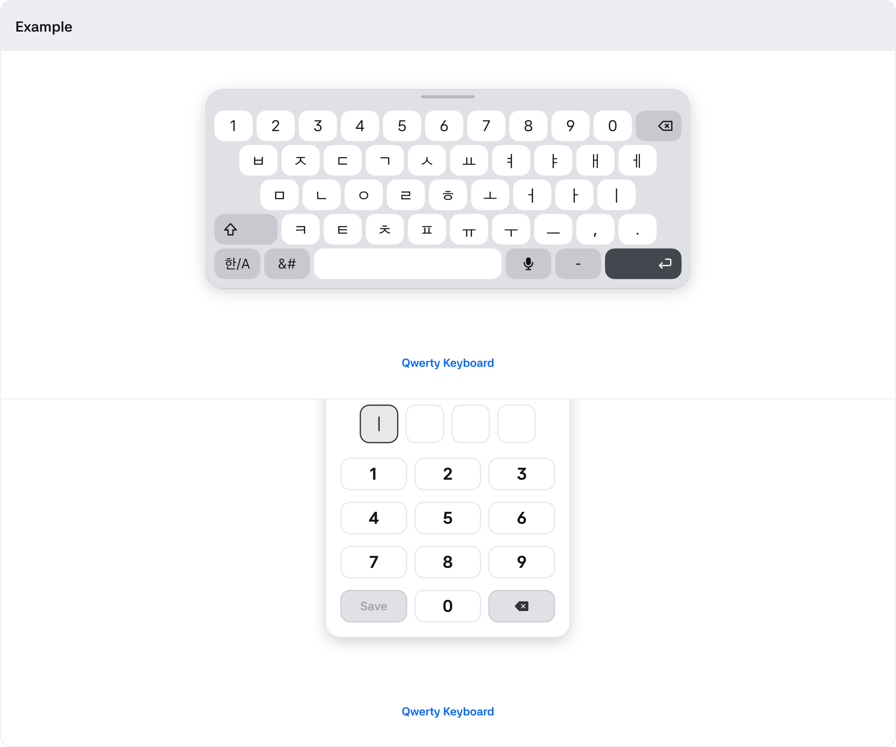

<!-- 원문: https://document.pleos.ai/docs/connect/guide/docs-design/components/actions/keypad -->
<!-- 가져온 날짜: 2026-11-12. 원문이 바뀌었을 수 있으니 중요한 결정 전에는 원문을 확인할 것. -->

# Keypad

#### 키패드는 숫자, 텍스트 등 서비스 사용 시 필요한 정보 입력을 위해 사용됩니다.

 

**1. Root** : 버튼을 감싸는 최상위 컨테이너 영역   **2. Label** : 버튼 레이블   **3. Icon**(Prefix) : Label에 대한 시각적 부연설명을 하는 아이콘 영역   **4. Icon**(Suffix) : Label에 대한 시각적 부연설명을 하는 아이콘 영역  

---

## States

| State | Value | Default | Description |
|---|---|---|---|
| Pressed | Boolean | False | 터치 상태일 때 True로 전환 |
| Pressed | Boolean | False | Drag 가능한 window일 때 True로 전환 |
| Disabled | Boolean | - | True일 경우, Button이 제어 불가능한 상태 |

 

---

## Properties

| State | Value | Description |
|---|---|---|
| Keypad | Primary, Secondary, Special | 키보드의 역할에 따라 다른 타입을 선택할 수 있습니다. |
| Keyboard | Text, Voice | 키패드 또는 음성을 통한 텍스트 입력을 지원합니다. |

     

 
