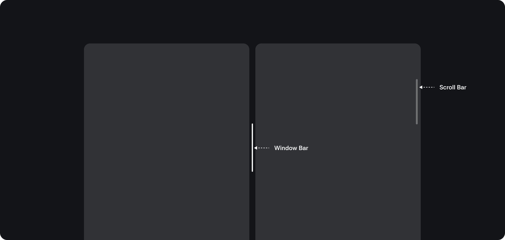
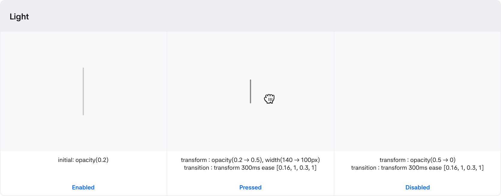
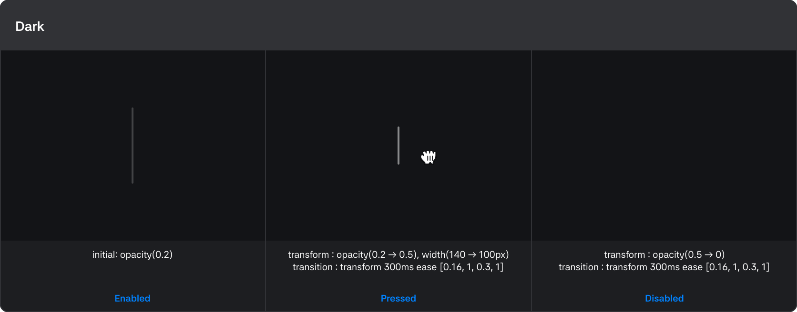
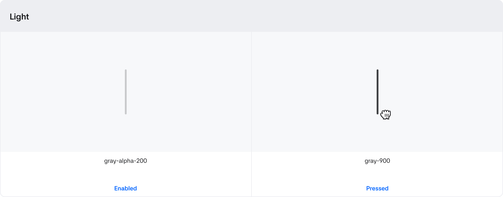
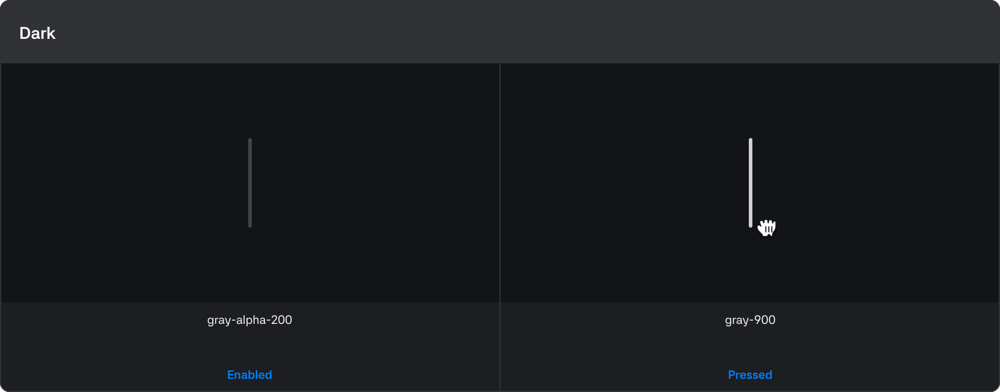

<!-- 원문: https://document.pleos.ai/docs/connect/guide/docs-design/components/bar -->
<!-- 가져온 날짜: 2026-11-12. 원문이 바뀌었을 수 있으니 중요한 결정 전에는 원문을 확인할 것. -->

# Bar

#### 디스플레이 내 앱 화면의 사이즈나 위치 조정 또는 콘텐츠 조작을 위한 요소입니다.

## States

| State | Value | Description |
|---|---|---|
| Variant | Light / Dark | App에서 정한 타입에 따라 전환 |
| Dragging | True / False | Drag 가능한 window일 때 'True'로 전환 |
| Disabled | True / False | True일 경우, handle이 안보이고 drag를 제어할 수 없는 상태 |
| Pressed | True / False | Handle을 잡고 drag를 시작할 때의 상태 |

---

## Types

| Types | Description |
|---|---|
| Window bar | App의 window 사이즈 조정을 위한 컴포넌트 |
| Scroll bar | App의 content를 탐색하기 위한 컴포넌트 |

---

## Window bar

**1. Root** : Window bar 컴포넌트를 감싸는 최상위 컨테이너 영역   **2. Control** : Handle과 최소 drag 영역을 감싸는 컨테이너 영역   **3. Handle** : Drag 할 수 있는 컨트롤 요소

## Behaviors

   

---

## Scroll bar

**1. Root** : Scroll bar 컴포넌트를 감싸는 최상위 컨테이너 영역   **2. Control** : Handle과 최소 drag 영역을 감싸는 컨테이너 영역   **3. Handle** : Drag 할 수 있는 컨트롤 요소

### Behaviors

   
