<!-- 원문: https://document.pleos.ai/docs/connect/guide/docs-design/components/controllers -->
<!-- 가져온 날짜: 2026-11-12. 원문이 바뀌었을 수 있으니 중요한 결정 전에는 원문을 확인할 것. -->

# Controllers

Controllers는 최솟값과 최댓값을 가지며, 범위 내 volume, temporature 등과 같은 속성을 슬라이더 또는 클릭을 통해 조작 가능한 컴포넌트입니다.

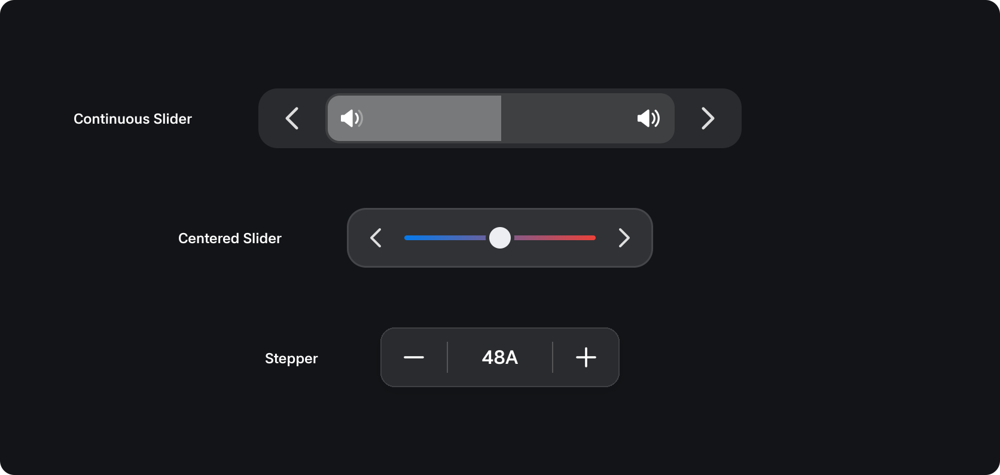

**States**  

| State | Value | Description |
|---|---|---|
| Pressed or Dragging | True / False | Handle 영역을 Pressed 시작할 때의 상태 |

 

**Options**  

| Options | Value | Description |
|---|---|---|
| Disabled | True / False | Min 또는 Max value에 도달했을 때 True로 전환 |
| MinValue | Number | 슬라이더에 지정하는 최솟값 |
| MaxValue | Number | 슬라이더에 지정하는 최댓값 |
| Step | Number | 슬라이더의 값을 제어하는 단계 지정 값 |

 

---

 

## Continuous Slider

### Anatomy

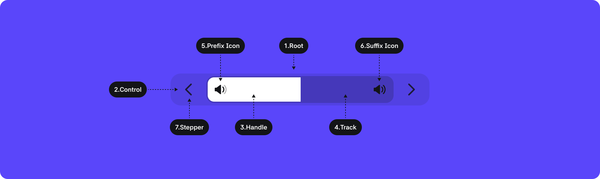 

**1. Root** : Slider 컴포넌트를 감싸는 최상위 컨테이너 영역   **2. Control** : Slider의 track과 handle을 감싸는 컨테이너 영역   **3. Handle** : 사용자가 드래그 할 수 있는 컨트롤 요소   **4. Track** : Handle이 움직일 수 있는 영역을 표현하는 요소   **5. Icon**(Prefix) : Label에 대한 시각적 부연설명을 하는 아이콘 영역(Optional)   **6. Icon**(Suffix) : Label에 대한 시각적 부연설명을 하는 아이콘 영역   **7. Stepper** : 버튼을 눌러 handle을 제어할 수 있는 컨트롤 요소 

---

### Behaviors

#### Slider

**Basic**   일반적인 슬라이더로 사용됩니다.

  

**Floating**   밝은 배경 또는 배경과 구분이 필요한 곳에서 사용됩니다.

  

#### Buttons

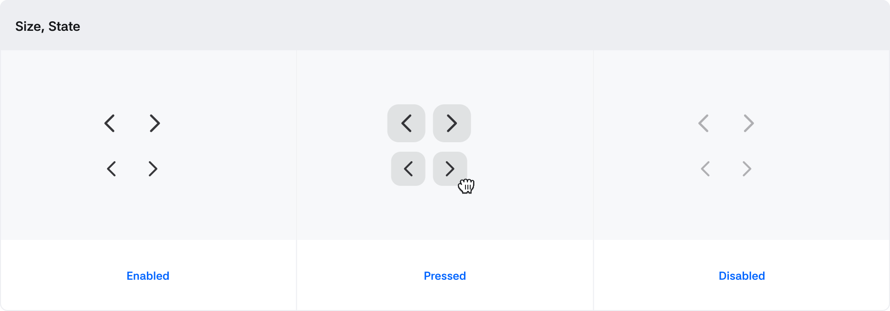 

---

#### Volume

**Max** 100%  

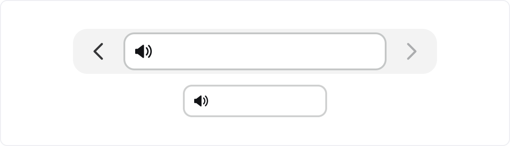 

**High** 76~100%  

 

**Mid** 26~75%  

 

**Low** 1~25%  

 

**Min** 0%  

 

---

#### Optional

**Label** True/False  

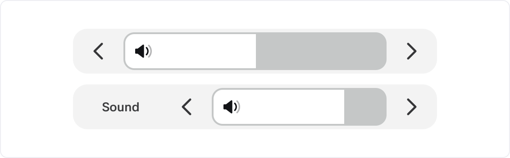 

**Icon** True/False  

 

#### Control

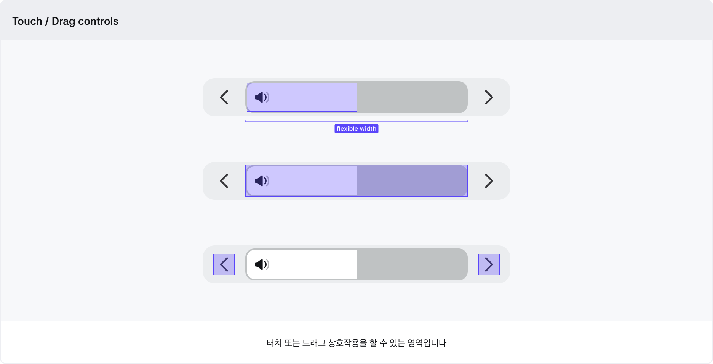

 

---

 

## Centered Slider

### Anatomy

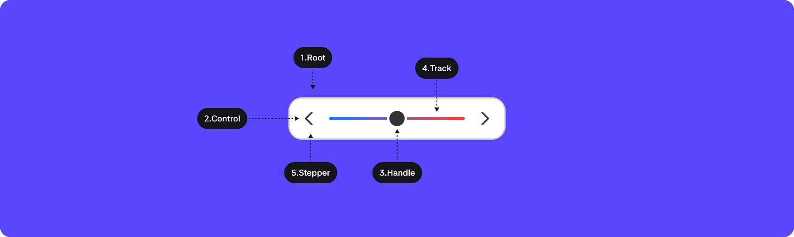 

**1. Root** : Slider 컴포넌트를 감싸는 최상위 컨테이너 영역   **2. Control** : Slider의 track과 handle을 감싸는 컨테이너 영역   **3. Handle** : 사용자가 드래그 할 수 있는 컨트롤 요소   **4. Track** : Handle이 움직일 수 있는 영역을 표현하는 요소   **5. Stepper** : 버튼을 눌러 handle을 제어할 수 있는 컨트롤 요소 

---

### Behaviors

**Slider**

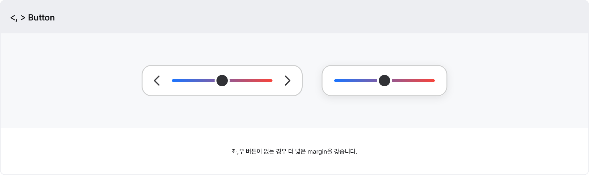  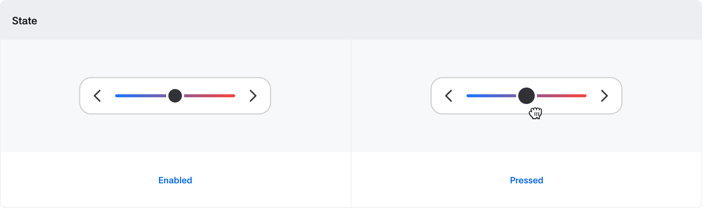 

**Track**

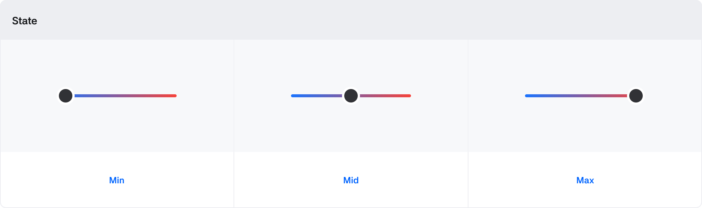  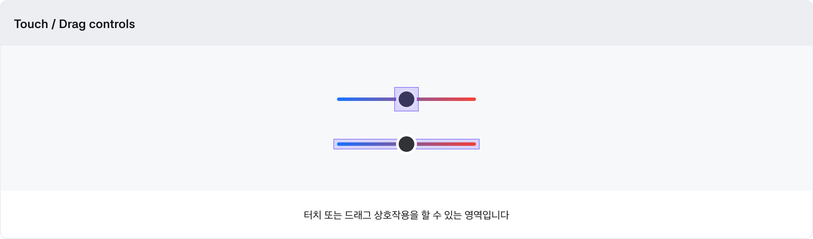

 

---

 

## Stepper

### Anatomy

 

**1. Root** : Stepper 컴포넌트를 감싸는 최상위 컨테이너 영역   **2. Current value** : Current value와 Step 버튼을 감싸는 컨테이너 영역   **3. i++** : Stepper 값이 증가하는 컨트롤 요소   **4. i--** : Stepper 값이 감소하는 컨트롤 요소  

 

### Behaviors

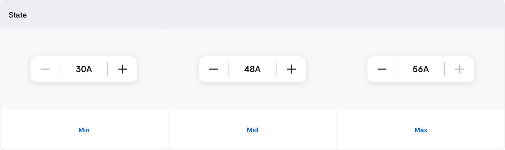  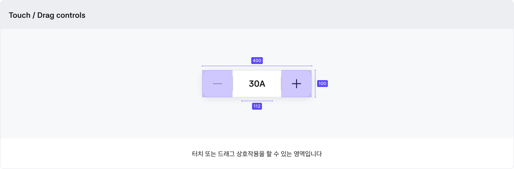 
