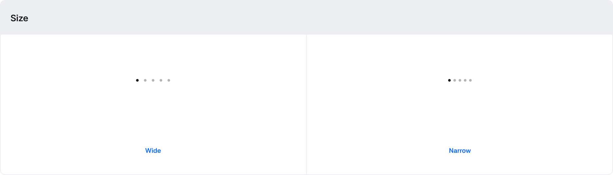

<!-- 원문: https://document.pleos.ai/docs/connect/guide/docs-design/components/indicator -->
<!-- 가져온 날짜: 2026-11-12. 원문이 바뀌었을 수 있으니 중요한 결정 전에는 원문을 확인할 것. -->

# Indicator

## Anatomy

**1. Root** : App bar 컴포넌트를 감싸는 최상위 컨테이너 영역   **2. Present Value** : 현재 선택된 value를 보여주는 영역   **3. Next, Prev Value** : 선택 가능한 value가 나열되어 보여지는 영역

 

### States & Options

**States**  

| State | Value | Description |
|---|---|---|
| Present | Boolean | 현재 Value가 Present에 해당할 때 True로 전환 |

| Option | Value | Description |
|---|---|---|
| Size | Wide / Narrow | Indicator 아이템의 사이즈 옵션 |

 

### Behaviors

