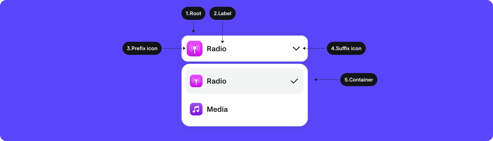
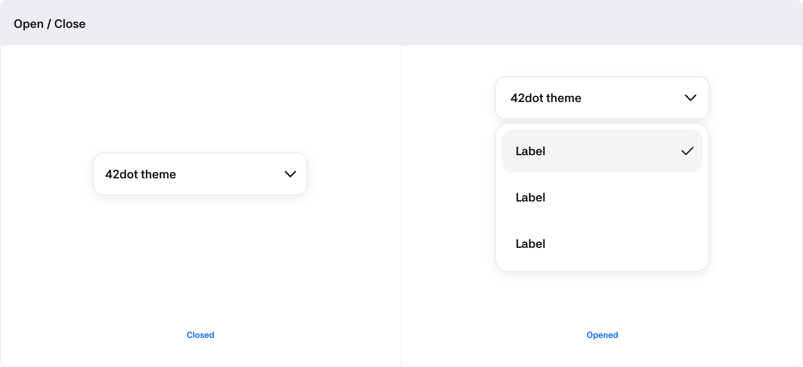
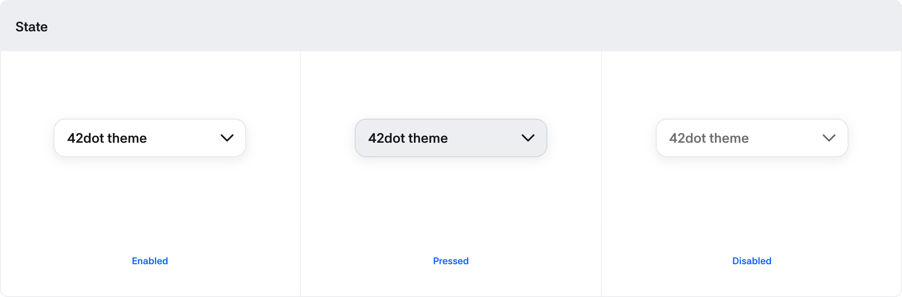
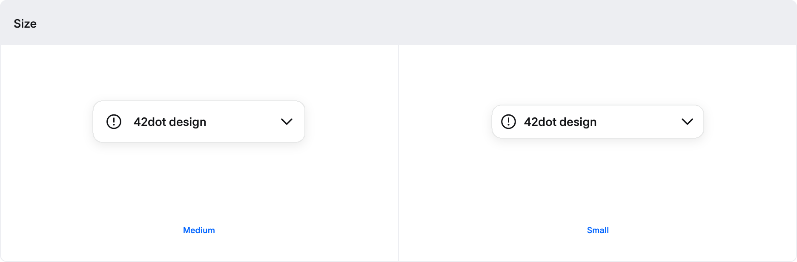
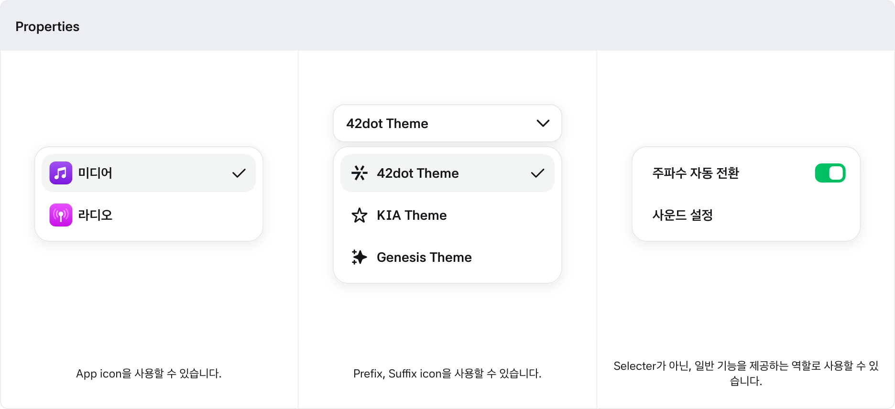

<!-- 원문: https://document.pleos.ai/docs/connect/guide/docs-design/components/dropdown -->
<!-- 가져온 날짜: 2026-11-12. 원문이 바뀌었을 수 있으니 중요한 결정 전에는 원문을 확인할 것. -->

# Dropdown

#### 메뉴의 이동이나 원하는 메뉴 속성 변경을 위한 요소입니다.

**1. Root** : Dropdown 컴포넌트를 감싸는 최상위 컨테이너 영역   **2. Label** : 버튼 레이블   **3. Prefix** : 메뉴 앞쪽에 제공되는 옵션 영역   **4. Suffix** : 메뉴 뒷쪽에 제공되는 옵션 영역   **5. Container** : Dropdown 요소를 담고 있는 영역

 

---

## States

| States | Value | Description |
|---|---|---|
| Opened | Boolean | Dropdown 컨테이너가 열린 상태일 때 True로 전환 |
| Pressed | Boolean | 터치로 클릭 중인 상태일 때 True로 전환 |
| Disabled | Boolean | True일 경우, Dropdown이 제어 불가능한 상태 |

 

 

---

## Properties

| Property | Value | Description |
|---|---|---|
| Prefix | App Icon, Icon | 메뉴 앞쪽에 제공되는 옵션 |
| Suffix | Switch, Icon | 메뉴 뒷쪽에 제공되는 옵션 |
| Size | Medium, Small | Dropdown, 컨테이너 아이템의 사이즈 옵션 |

 

 
