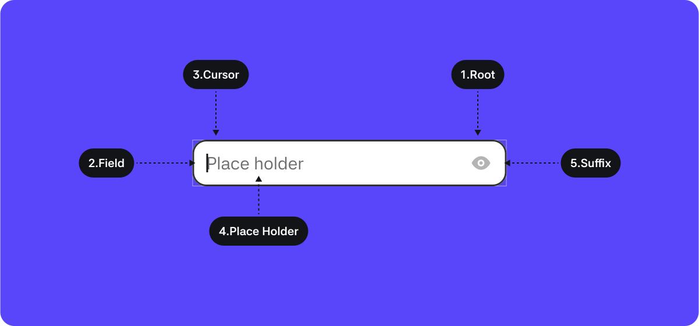
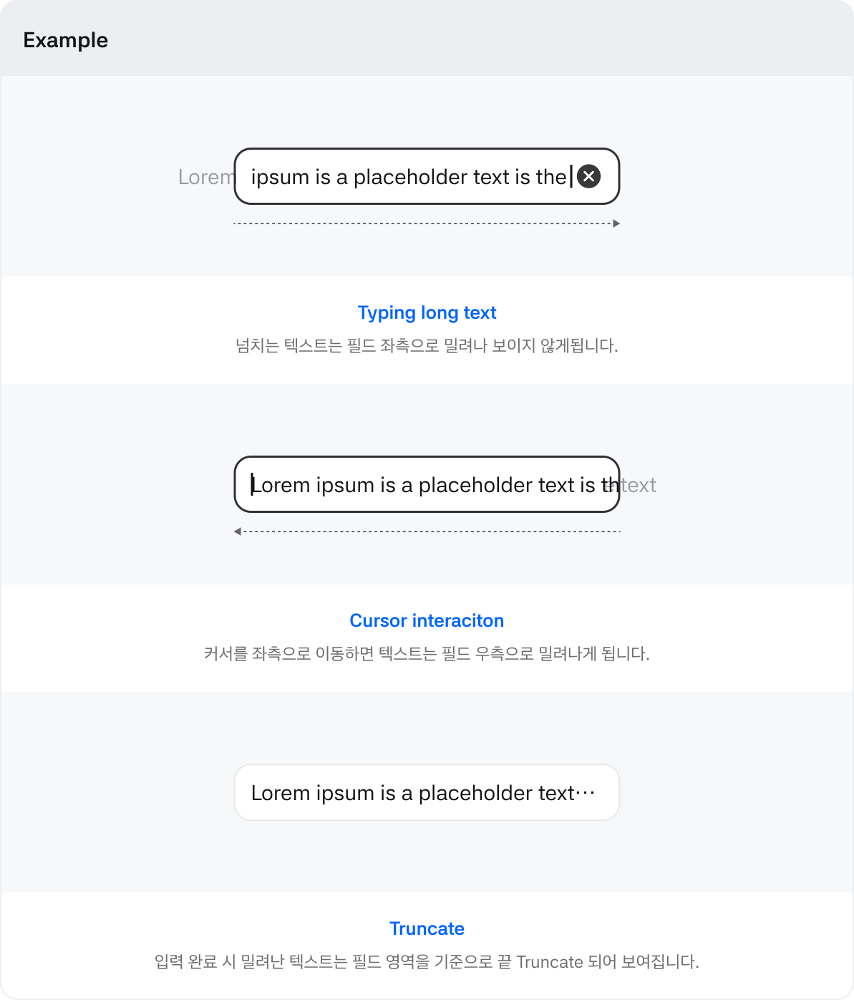
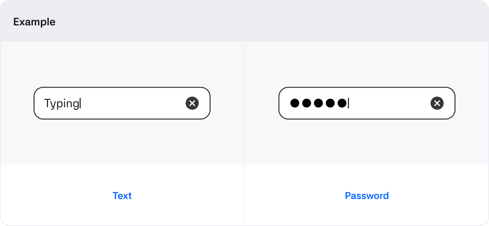

<!-- 원문: https://document.pleos.ai/docs/connect/guide/docs-design/components/fields/text-field -->
<!-- 가져온 날짜: 2026-11-12. 원문이 바뀌었을 수 있으니 중요한 결정 전에는 원문을 확인할 것. -->

# Text Field

#### 텍스트, 비밀번호, 이메일 등 다양한 텍스트 정보 입력을 위한 필드입니다.

**1. Root** : 텍스트 필드 전체를 감싸는 최상위 컨테이너 영역   **2. Field** : 사용자가 정보를 입력하는 영역   **3. Cursor** : 텍스트를 입력할 수 있는 상태에 제공되는 커서 요소   **4. Place Holder** : 입력해야 하는 텍스트 필드 정보 맥락을 제공하는 라벨   **5. Suffix** : 텍스트 필드에 작성될 값의 맥락을 텍스트, 아이콘으로 표시하여 주는 영역(Optional)  

 

---

## States

| State | Value | Description |
|---|---|---|
| Value | String | Text field에 입력된 텍스트 정보 |
| Focused | True / False | 터치 또는 보이스 접근 시 text field 영역을 인식하고 있는 상태일 때 True로 전환 |
| Disabled | True / False | True일 경우, text field 입력 및 접근이 불가능한 상태. Focused state가 작동하지 않음 |
| Read Only | True / False | True일 경우, text field가 입력 값에 접근할 순 있지만 변경할 순 없는 상태. Focused state는 작동하는 상태 |
| Invalid | True / False | 입력 값이 유효한 값인지 아닌지 여부를 체크하는 상태 |

## Typing Interaction

## Properties

| Property | Value | Description |
|---|---|---|
| Type | Text / Tel / Url / Email / Password | Text field의 유형 |
| Size | Medium, Samll | Text field의 사이즈 |

