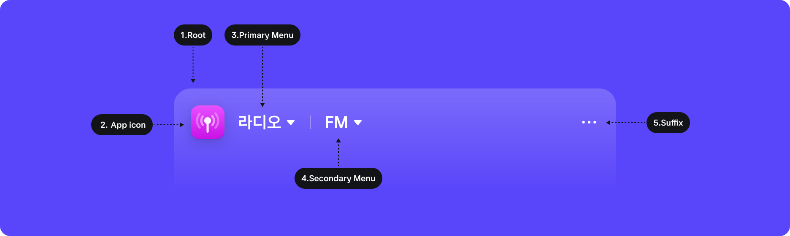
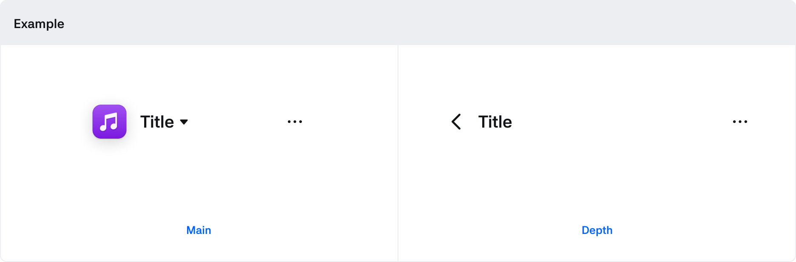
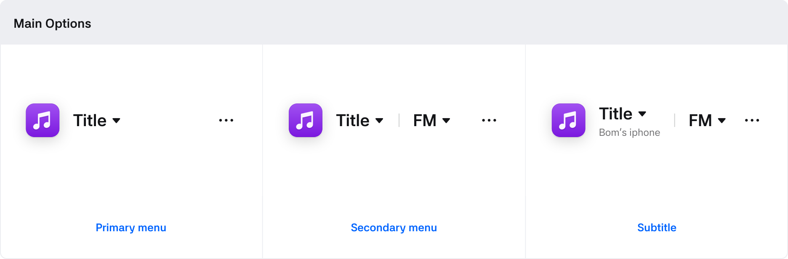
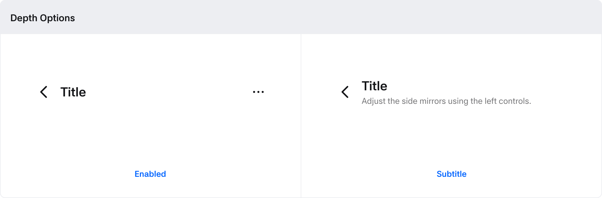

<!-- 원문: https://document.pleos.ai/docs/connect/guide/docs-design/components/page-navigation -->
<!-- 가져온 날짜: 2026-11-12. 원문이 바뀌었을 수 있으니 중요한 결정 전에는 원문을 확인할 것. -->

# Page Navigation

#### 앱 서비스를 위해 필요한 주요 고객 경험 여정을 제공하기 위한 요소입니다.

**1. Root** : Page Navigation 컴포넌트를 감싸는 최소단위 컨테이너 영역   **2. App icon** : 앱 아이콘을 나타내는 시각 요소   **3. Primary Menu** : 페이지 첫번째 카테고리를 그룹핑하는 Dropdown Menu   **4. Secondary Menu** : 페이지 두번째 그룹에 대한 Dropdown Menu(Optional)   **5. Suffix** : 페이지에 필요한 기타 메뉴에 대한 아이콘 메뉴, 앱의 목적에 따라 교체 가능

---

## Types

| Type | Value | Description |
|---|---|---|
| Main | Boolean | 기본으로 제공 되는 메뉴 |
| Depth | Boolean | Depth 상태일 경우 True로 전환 (페이지 이동 시 Back 버튼이 나오는 경우) |

 

---

## Properties

| Properties | Value | Description |
|---|---|---|
| Primary | App Icon, Suffix | Depth 상태일 경우 True로 전환(페이지 이동 시 Back 버튼이 나오는 경우) |
| Secondary | Boolean | 터치로 클릭 중인 상태일 때 True로 전환   |
| Subtitle | Boolean | 영역의 부가 정보를 제공하기 위한 경우 True로 전환   |

 

 
