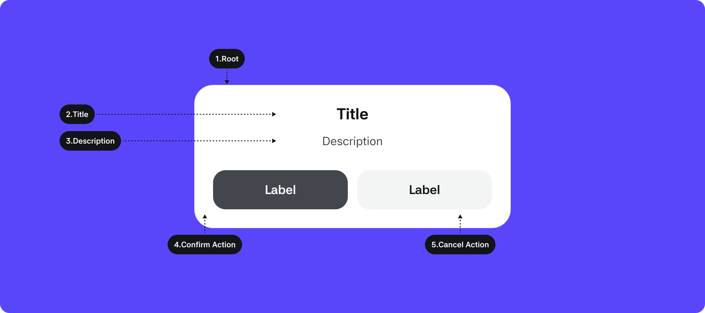
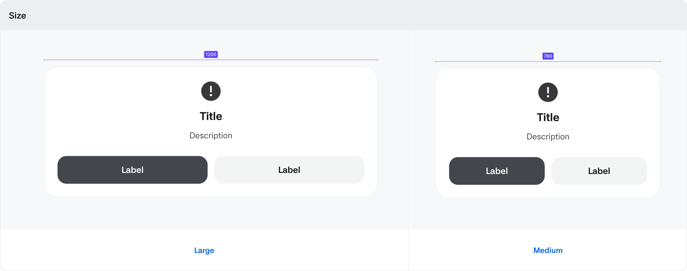
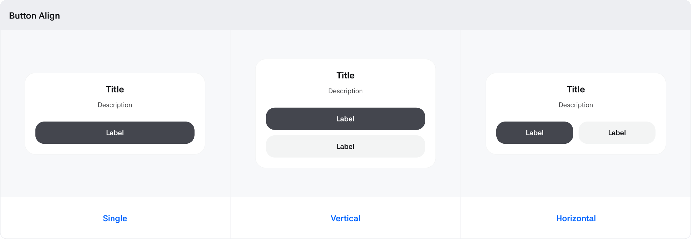
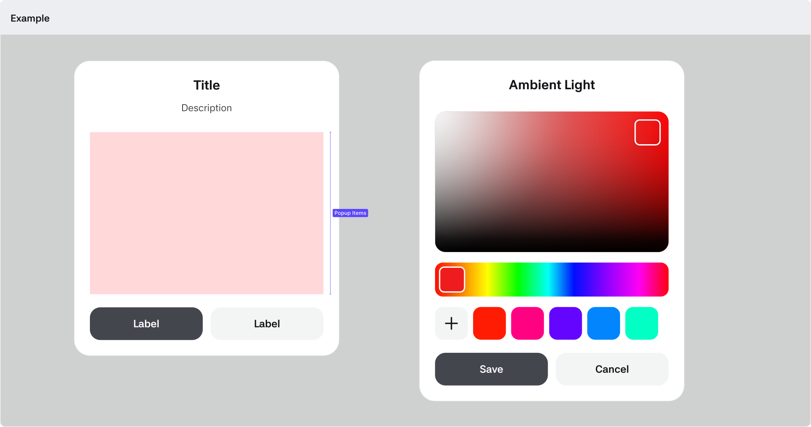

<!-- 원문: https://document.pleos.ai/docs/connect/guide/docs-design/components/popups/system-popup -->
<!-- 가져온 날짜: 2026-11-12. 원문이 바뀌었을 수 있으니 중요한 결정 전에는 원문을 확인할 것. -->

# System Popup

#### 앱 내에서 기본적으로 제공되는 팝업으로 서비스의 맥락에 맞게 Body 영역에 콘텐츠도 제공할 수 있습니다.

**1. Root** : Popup 컴포넌트를 감싸는 최상위 컨테이너 영역   **2. Title** : Popup의 주요 텍스트가 표시되는 영역   **3. Description** : Dialog가 사용자에게 전달하고자 하는 주요 텍스트 (Optional)   **4. Confirm Action** : Popup이 전달하는 내용을 확인했거나, 다른 진입점으로 링크해주는 버튼   **5. Cancel Action** : Popup을 취소하거나 닫을 수 있는 버튼 (Optional)  

 

---

## Properties

| Property | Value | Description |
|---|---|---|
| Header | Icon, SubTitle, Description | True일 경우, Header 노출 |
| Body | Boolean | True일 경우 Header와 Body사이 설정된 콘텐츠 노출 |
| Size | Large, Medium | 팝업의 사이즈 종류 |
| Button Align | Single / Vertical / Horizontal | 버튼 정렬에 따른 옵션 |

 

## Body Contents

Body 영역은 사용자에게 전달하고자 하는 주요 팝업 아이템을 보여줄 수 있습니다.

 
