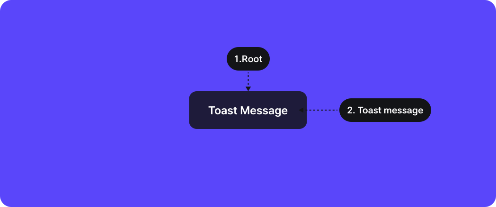
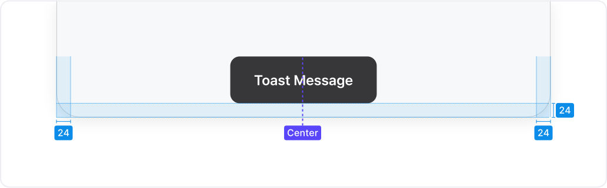
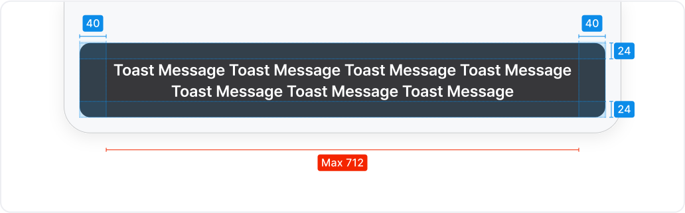

<!-- 원문: https://document.pleos.ai/docs/connect/guide/docs-design/components/popups/toast-popup -->
<!-- 가져온 날짜: 2026-11-12. 원문이 바뀌었을 수 있으니 중요한 결정 전에는 원문을 확인할 것. -->

# Toast Popup

#### 앱 서비스를 운영 중 필요한 일시적인 알림을 제공할 수 있는 요소입니다.

**1. Root** : 컴포넌트를 감싸는 최소단위 컨테이너 영역   **2. Toast message** : 알림 메시지

 

---

## Guideline

앱에서 필요한 시스템 메시지를 24dp 공간을 두고 Max로 제공할 수 있습니다.

 

 
