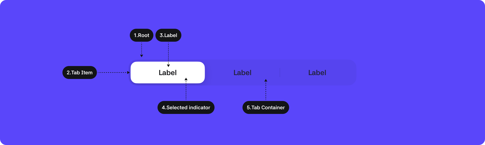
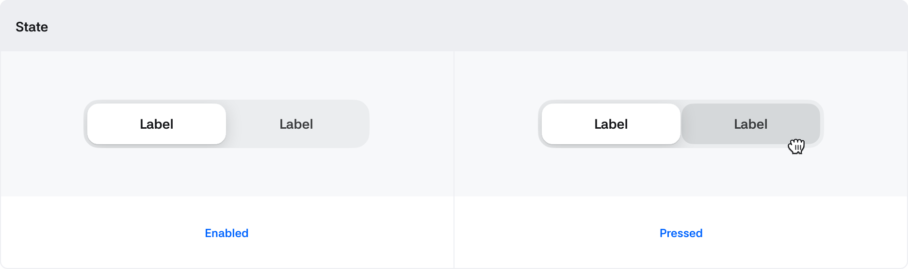

<!-- 원문: https://document.pleos.ai/docs/connect/guide/docs-design/components/segmented-menu -->
<!-- 가져온 날짜: 2026-11-12. 원문이 바뀌었을 수 있으니 중요한 결정 전에는 원문을 확인할 것. -->

# Tabs

#### 2개 이상의 콘텐츠나 기능 옵션을 제공하기 위한 요소입니다.

**1. Root** : Tabs 컴포넌트를 감싸는 최상위 컨테이너 영역   **2. Tab Item** : 사용자가 선택하여 전환시킬 수 있는 컨텐츠(페이지) 그룹   **3. Label** : Tab item에 대한 정보를 전달하는 라벨   **4. Selected indicator** : 사용자가 선택한 Tab item을 나타내는 요소   **5. Tab Container** : Tab item이 나열되는 영역

 

---

## States

| States | Value | Description |
|---|---|---|
| Enable | Boolean | 터치 가능한 기본 상태 |
| Pressed | Boolean | 터치로 클릭 중인 상태일 때 True로 전환 |
| Selected | Boolean | Tabs 컴포넌트에서 입력되는 선택값 |

 

---

## Properties

| Property | Value | Description |
|---|---|---|
| Type | Box, Line | 2가지 스타일의 Tab 종류 |
| Fitted | Boolean | True일 경우, Tabs의 너비에 맞게 Tab들이 일정한 간격으로 늘어남   False일 경우, Left Aligned 정렬로 표현됨 |

 

 
