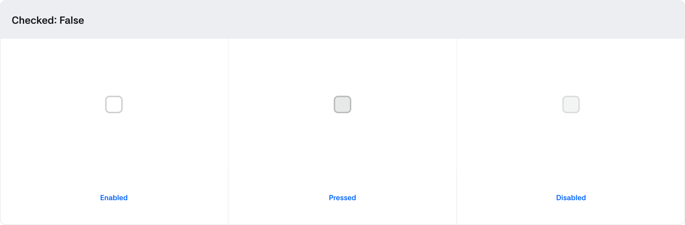
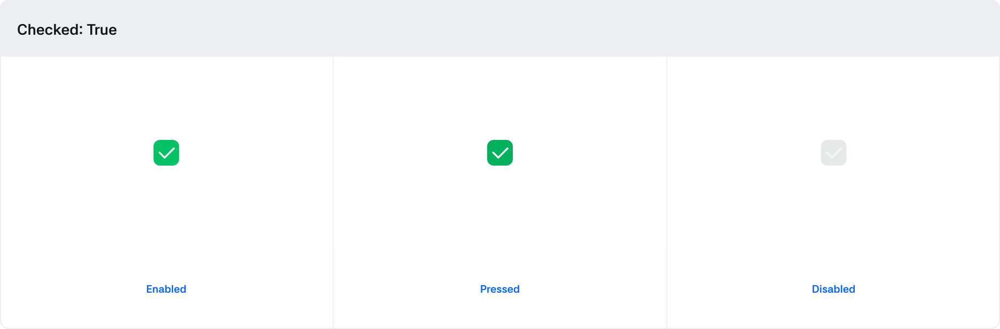

<!-- 원문: https://document.pleos.ai/docs/connect/guide/docs-design/components/selections/checkbox -->
<!-- 가져온 날짜: 2026-11-12. 원문이 바뀌었을 수 있으니 중요한 결정 전에는 원문을 확인할 것. -->

# Checkbox

#### 차량 내 조작이 필요한 스위치 중 하나로 다중 선택이 가능한 옵션을 제공할 수 있습니다.

**1. Root** : Checkbox 컴포넌트를 감싸는 최소 단위 컨테이너 영역   **2. Control** : 체크박스의 상태를 나타내는 시각 요소   **3. Icon** : 체크박스에 대한 정보를 전달하는 아이콘

 

---

## States

| State | Value | Description |
|---|---|---|
| Checked | Boolean | Checkbox가 체크된 상태일 때 True로 전환 |
| Pressed | Boolean | 터치로 클릭 중인 상태일 때 True로 전환 |
| Disabled | Boolean | True일 경우, checkbox 제어 불가능한 상태 |

 

## Behaviors

 

 
