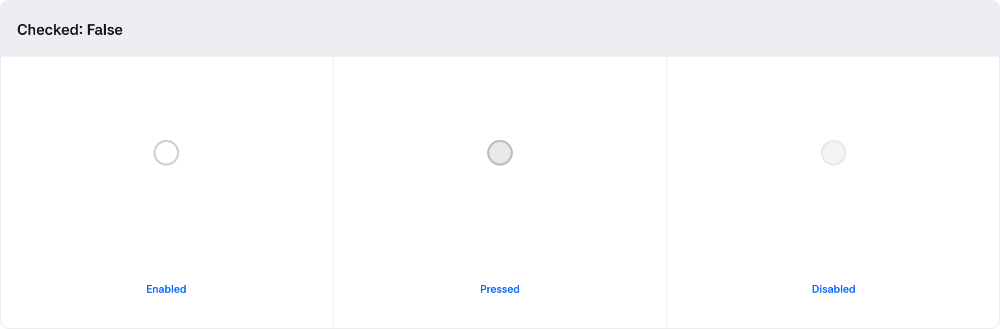
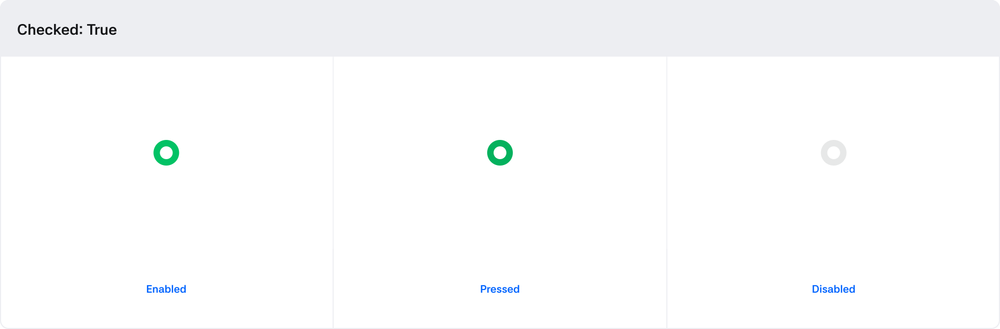

<!-- 원문: https://document.pleos.ai/docs/connect/guide/docs-design/components/selections/radio -->
<!-- 가져온 날짜: 2026-11-12. 원문이 바뀌었을 수 있으니 중요한 결정 전에는 원문을 확인할 것. -->

# Radio button

#### 차량 내 조작이 필요한 스위치 중 하나로 독립적인 선택 옵션을 제공할 때 사용됩니다.

**1. Root** : Checkbox 컴포넌트를 감싸는 최소단위 컨테이너 영역   **2. Control** : 체크박스의 상태를 나타내는 시각 요소  

---

## States

| State | Value | Description |
|---|---|---|
| Value (Selected) | Num / Null | Null: 선택되지 않은 Radio   Num: 선택된 Radio의 순서 값 |
| Pressed | Boolean | 터치로 클릭 중인 상태일 때 True로 전환 |
| Disabled | Boolean | True일 경우, Radio 제어 불가능한 상태 |
| Invalid | Boolean | True일 경우, 유효하지 않은 값임을 나타냄 |

## Behaviors

 

 
