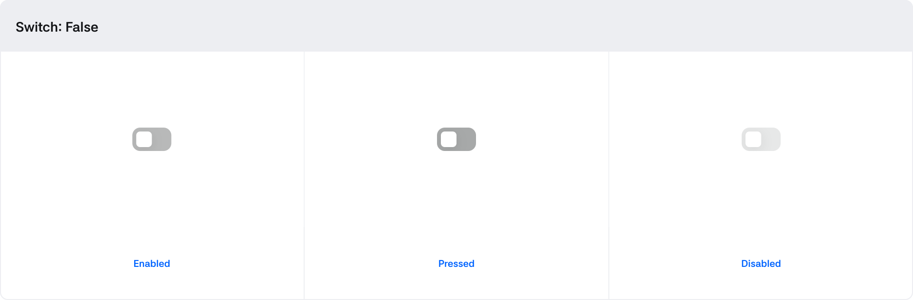
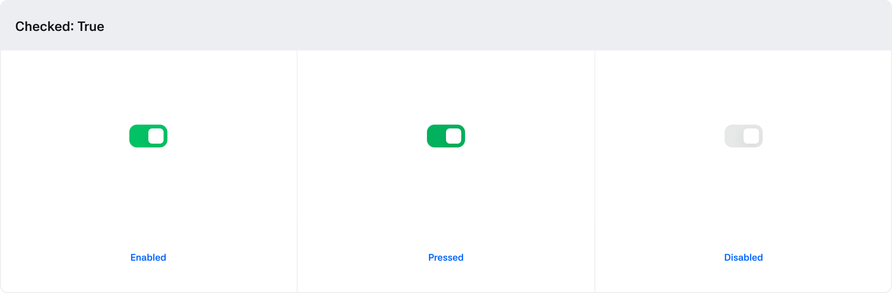

<!-- 원문: https://document.pleos.ai/docs/connect/guide/docs-design/components/selections/switches -->
<!-- 가져온 날짜: 2026-11-12. 원문이 바뀌었을 수 있으니 중요한 결정 전에는 원문을 확인할 것. -->

# Switch

#### 차량 내 조작이 필요한 스위치 중 하나로 On/Off를 통해 상태 변경이 필요할 때 사용됩니다.

**1. Root** : 스위치 컴포넌트를 감싸는 최소단위 컨테이너 영역   **2. Handle** : 스위치를 제어에 관여하는 시각요소   **3. Track** : 스위치의 상태를 나타내는 시각요소

 

---

## States

| State | Value | Description |
|---|---|---|
| Checked | On/Off | Switch의 ON/OFF 여부에 따라 상태 전환 |
| Pressed | Boolean | 터치로 클릭 중인 상태일 때 True로 전환 |
| Disabled | Boolean | True일 경우, Button이 제어 불가능한 상태 |
| Invalid | Boolean | True일 경우, 유효하지 않은 값임을 나타냄 |

 

## Behaviors

 

 
