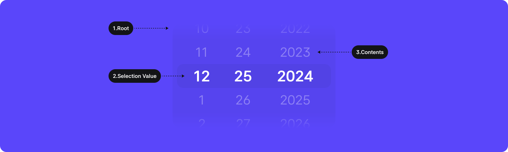
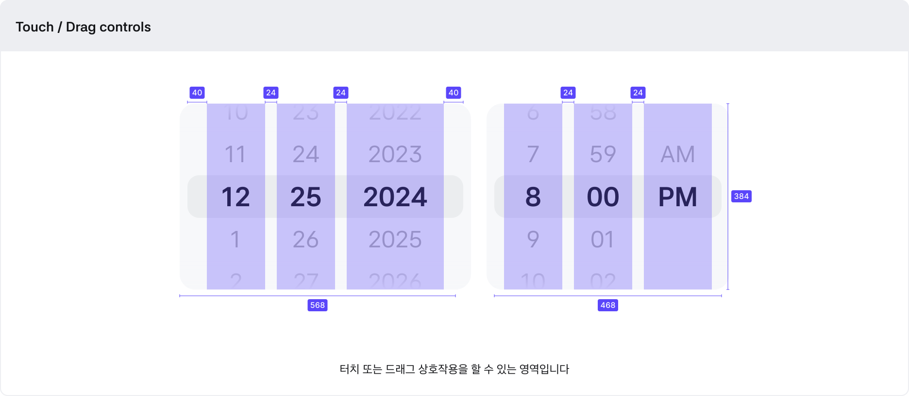

<!-- 원문: https://document.pleos.ai/docs/connect/guide/docs-design/components/spinner -->
<!-- 가져온 날짜: 2026-11-12. 원문이 바뀌었을 수 있으니 중요한 결정 전에는 원문을 확인할 것. -->

# Spinner

#### Drag를 통해 여러 옵션 중 하나를 선택할 수 있는 기능을 제공할 수 있습니다.

**1. Root** : 컴포넌트를 감싸는 최상위 컨테이너 영역   **2. Selection Value** :현재 선택된 value를 보여주는 영역   **3. Contents** : 선택 가능한 value가 나열되어 보여지는 영역

 

## Properties

| Type | Description |
|---|---|
| Date | 날짜를 기반으로 선택 가능 |
| Time | 시간을 기반으로 선택 가능 |

## Interaction Guide

 
