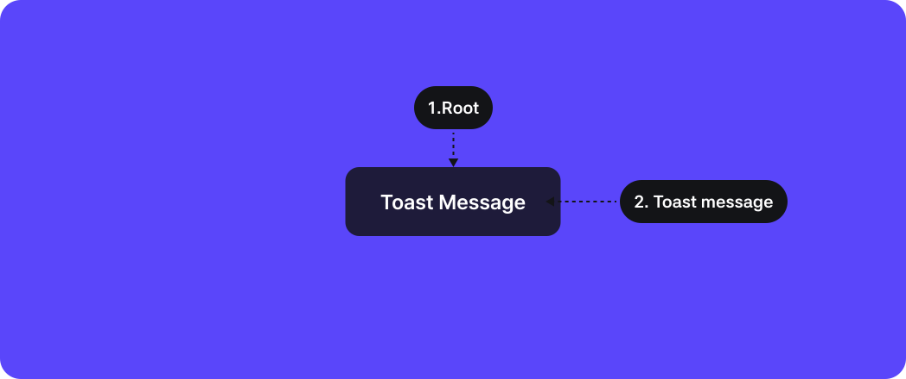
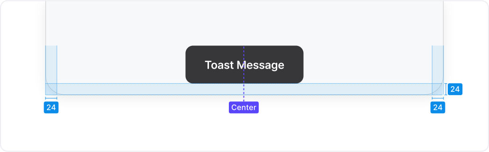
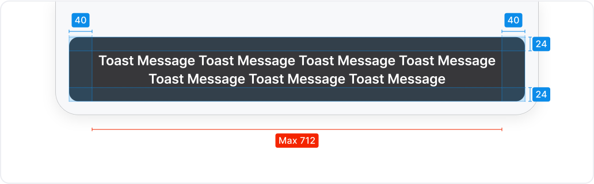

<!-- 원문: https://document.pleos.ai/docs/connect/guide/docs-design/components/toast -->
<!-- 가져온 날짜: 2026-11-12. 원문이 바뀌었을 수 있으니 중요한 결정 전에는 원문을 확인할 것. -->

# Toast

## Anatomy

**1. Root** : 컴포넌트를 감싸는 최소단위 컨테이너 영역   **2. Toast message** : 알림 메시지

 

## Behaviors

** Padding ** App panel 내 side padding 24, bottom padding 24

** Max width ** Toast 전체 max width 792 Message text max width 712

