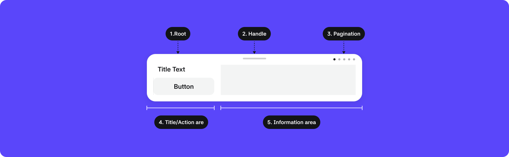
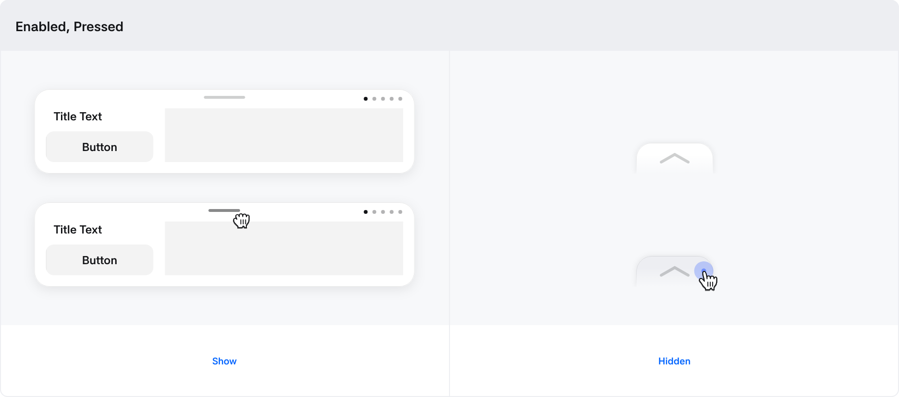
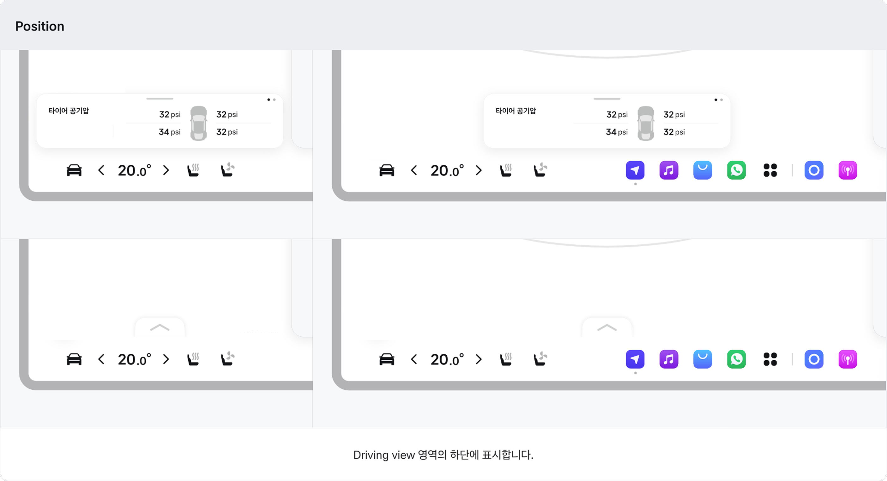
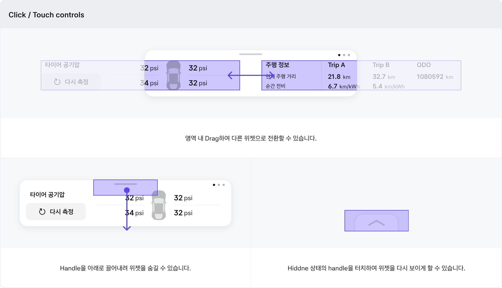

<!-- 원문: https://document.pleos.ai/docs/connect/guide/docs-design/components/widgets -->
<!-- 가져온 날짜: 2026-11-12. 원문이 바뀌었을 수 있으니 중요한 결정 전에는 원문을 확인할 것. -->

# Widgets

## Anatomy

**1. Root** : 컴포넌트를 감싸는 최상위 컨테이너 영역   **2. Handle** : 아래로 끌어내려 위젯을 숨길 수 있는 영역   **3. Pagination** : 확인 가능한 위젯의 개수와 현재 확인 중인 위젯의 순서를 파악   **4. Title/Action area** : 위젯의 타이틀 및 조작 영역   **5. Information area** : 위젯이 제공하는 주요 정보 영역  

## Properties

 

## Interaction

