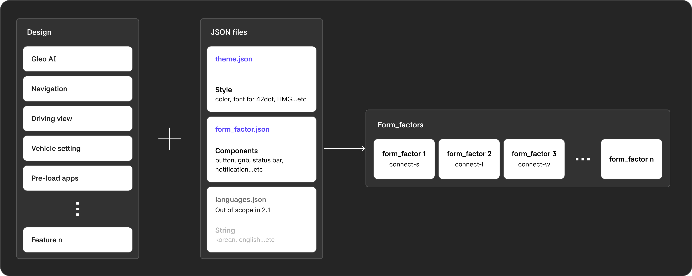
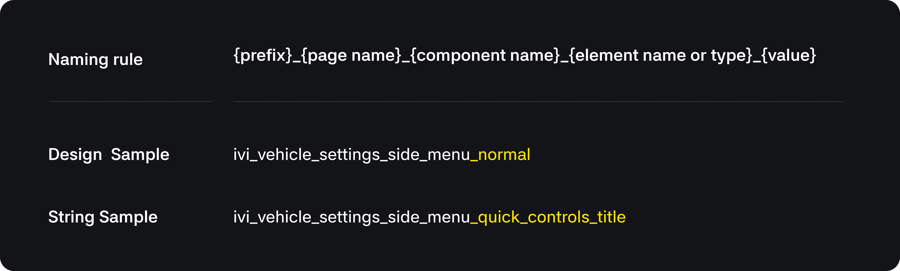

<!-- 원문: https://document.pleos.ai/docs/connect/guide/docs-design/Introduction/design-token -->
<!-- 가져온 날짜: 2026-11-12. 원문이 바뀌었을 수 있으니 중요한 결정 전에는 원문을 확인할 것. -->
<!-- 이 페이지는 원문 사이트의 사이드바·이전/다음 네비게이션에 노출되지 않습니다. URL로만 접근할 수 있습니다. -->

# Design Token

디자인 토큰은 디자인 시스템의 "스타일 속성 값(색상, 폰트, 간격, 그림자 등)"을 코드로 추상화 단위입니다. 이 토큰은 플랫폼 간 일관성을 유지하며 디자인을 구현하기 위한 "싱글 소스 오브 트루스(Single Source of Truth)"로 활용됩니다.

## 사용 목적

- 시스템 전체에서 일관된 UI 구현
- 디자이너와 개발자 간의 공통 언어 형성
- 유지보수 비용 절감 및 스케일 가능한 구조 제공
- 다크모드 / 라이트모드 / 브랜드 테마 전환 용이

## 구조

## 이름 규칙

1. 토큰 이름은 약속된 규칙에 따라 생성됩니다.

    - Prefix : ivi
    - Type : Snake case
2. 디자이너나 개발자는 토큰 이름을 통해 어디에서 사용되는 요소인지 인지할 수 있어야 합니다.
3. 토큰 이름은 축약된 언어가 아닌, 전체 이름을 풀어서 쓰도록 합니다.

  > 예시. Do : vertical / Don’t : v   Do : vehicle_setting / Don’t : vs
