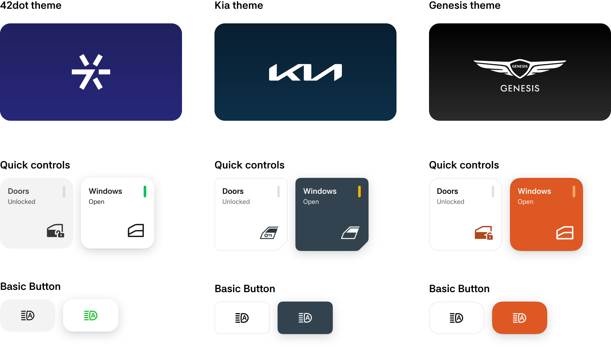
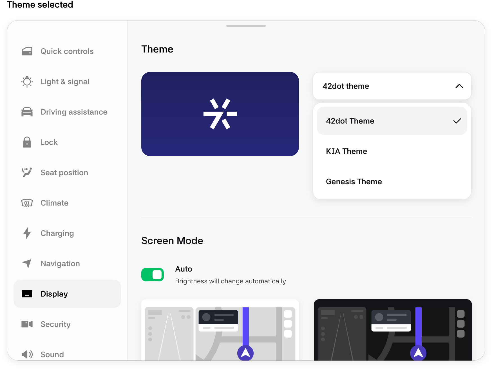

<!-- 원문: https://document.pleos.ai/docs/connect/guide/docs-design/Introduction/theme -->
<!-- 가져온 날짜: 2026-11-12. 원문이 바뀌었을 수 있으니 중요한 결정 전에는 원문을 확인할 것. -->
<!-- 이 페이지는 원문 사이트의 사이드바·이전/다음 네비게이션에 노출되지 않습니다. URL로만 접근할 수 있습니다. -->

# Theme

테마는 아이콘, 폰트, 그리고 컬러를 중심으로 브랜드 아이덴티티를 유지하기 위하여 사용합니다.

## Types

## Theme selected

## Theme samples

 (원격 이미지: 4 MB라 로컬에 저장하지 않음)
