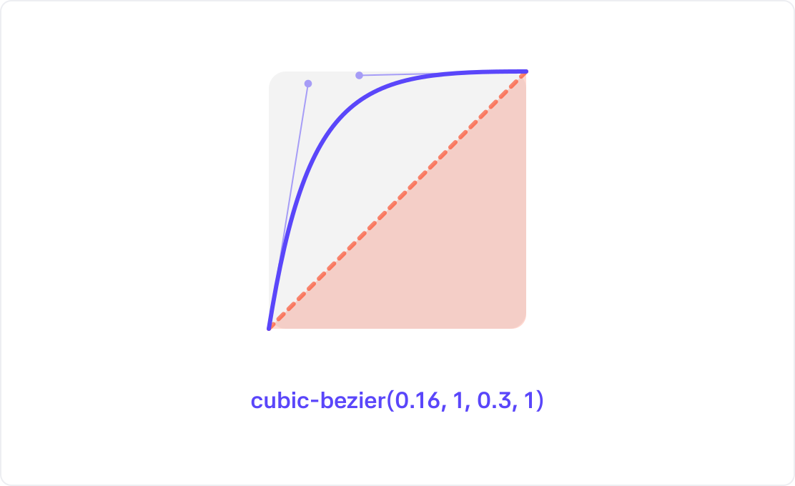
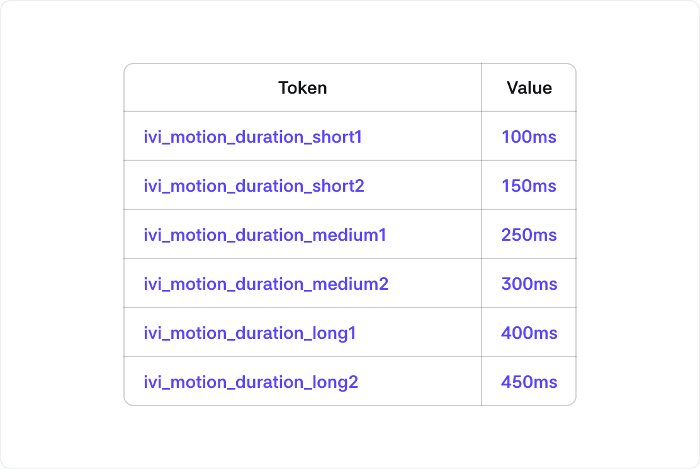
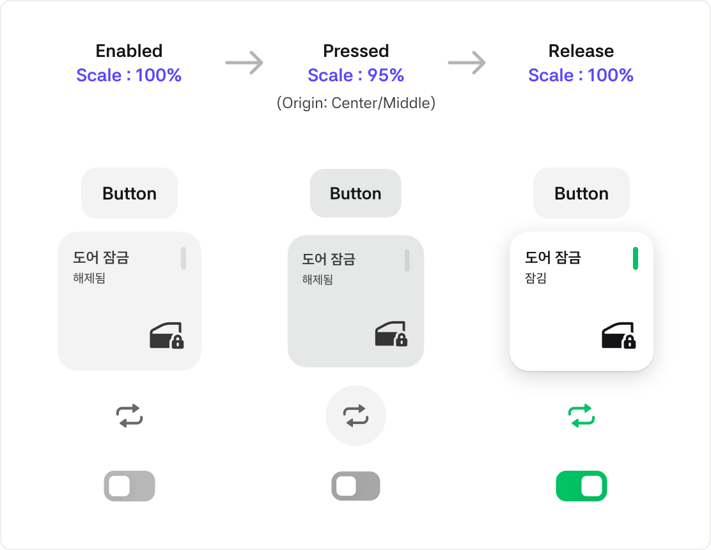
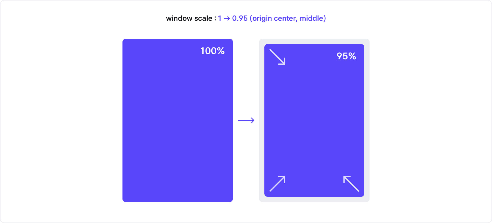
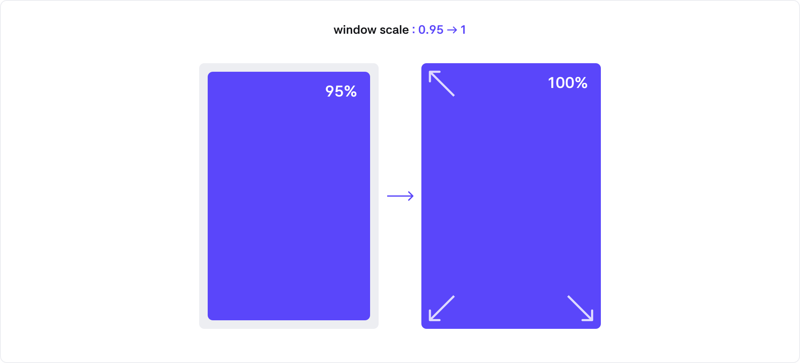
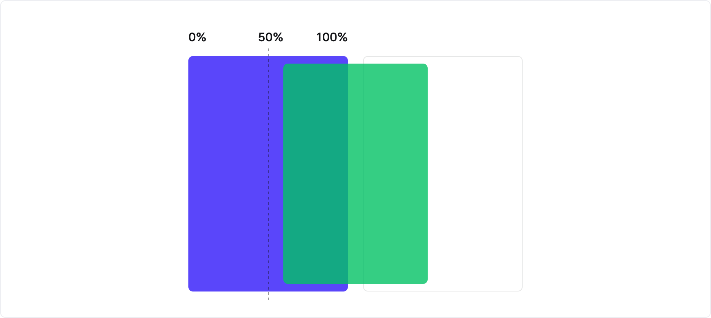
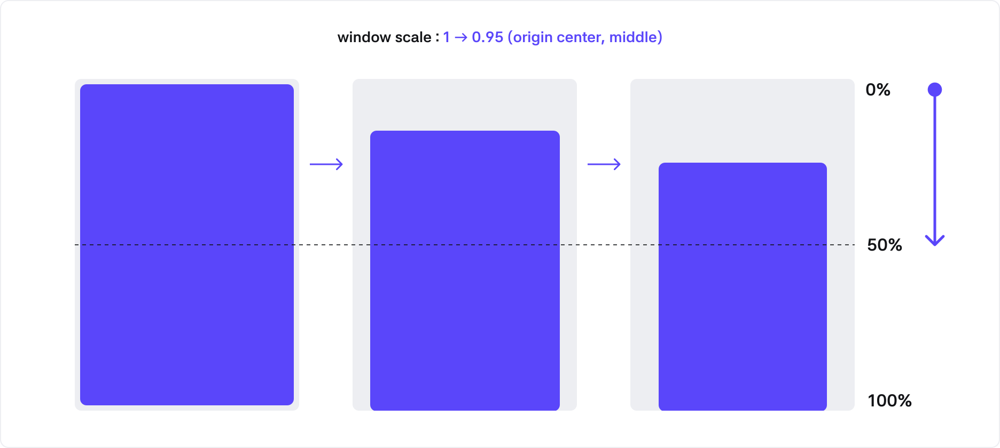
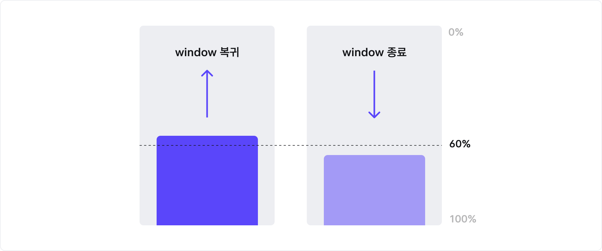
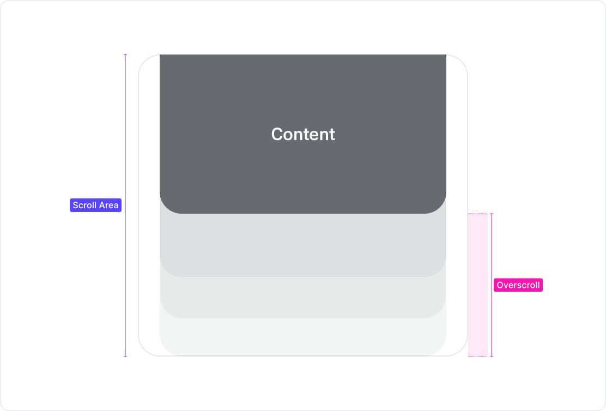

<!-- 원문: https://document.pleos.ai/docs/connect/guide/docs-design/foundations/interaction -->
<!-- 가져온 날짜: 2026-11-12. 원문이 바뀌었을 수 있으니 중요한 결정 전에는 원문을 확인할 것. -->
<!-- 이 페이지는 원문 사이트의 사이드바·이전/다음 네비게이션에 노출되지 않습니다. URL로만 접근할 수 있습니다. -->

# Interaction

## Tension

기본적인 Interaction을 구성하는 Tension 값입니다.

### Easing

### Durations

- **Short durations** : These are used for small utility-focused transitions.
- **Medium durations** : These are used for transitions that traverse a medium area of the screen.
- **Long durations** : These durations are often paired with Emphasized easing. They're used for large expressive transitions.

## Gestures

| Types | Description |
|---|---|
| Pressed | Vehicle Setting, Climate, Apps 선택 시 각 버튼과 연결된 영역 실행/종료 |
| Long Pressed | Vehicle Setting, Climate, Apps 2-3초 홀드 시 편집 활성화 |
| Swipe | Pressed 후 Left/Right/Top/Bottom에 대한 이동 값이 있을 경우 부여된 값 호출, 그 외에는 모두 Cancel 처리되며, 일정 속도 이하는 Drag 처리 됩니다.   예) - Window Bar Swipe Down: 앱 종료 - Climate 숫자 Swipe Left/Right: 공조 온도 상/하 조절 |
| Drag & Drop | Pressed 후 Left/Right/Top/Bottom에 대한 이동 값이 있을 경우 부여된 값 호출, 그 외에는 모두 Cancel 처리되며, 일정 속도 이상은 Swipe 처리 됩니다.   예) - Window Bar Swipe Down: 앱 종료 - Climate 숫자 Swipe Left/Right: 공조 온도 상/하 조절 |

## Interaction

### Button interaction

버튼 및 터치 가능한 요소는 모두 shrink effect가 적용되었습니다.

**Step1. Enabled** : This is the default state of a component before it is touched.   **Step2. Pressed** : Change to scale down(95%) + background color by Mode.  

- Add Background : Included a background with effect, and button should add different background color
- Cancel : If customers move out from touch area, cancel release  

**Step3. Release** : When finger point is pressed out in touch area, release the interaction such as App Release, Change state...etc

### Window interaction

각 window 또한 사용자의 니즈에 맞춰 조작 시 일관성 있는 effect가 적용되었습니다.

#### Drag start

Window bar를 누르기 시작하면, 수축이 시작됩니다.

#### Drag end

Window bar를 누르기 종료 시, 수축이 사라집니다.

#### Reorder(앱 이동)

다른 window width의 translateX(50%) 이상 이동 시 window 바로 이동

 

#### Close(앱 종료)

0 ~ 50% 사이 Y축으로 drag할 경우 (*Window height 100% 기준, y축으로 이동)

51 ~ 100% 사이 Y축으로 drag할 경우

0 ~ 59%(기존 74%) 이내 drag 종료할 경우 이벤트 복귀   60%(기존 75%) 이후 drag end할 경우 window 종료

 

### End of scoll

- ** Bounce Effect ** : In order to awareness, we provide the bounce effect in end area (ex Page, Menu, Carousel, List...etc)
- ** Range ** : The maximum allowable range of overscroll is approximate. 2/5 of the total scroll area horizontally or vertically.

