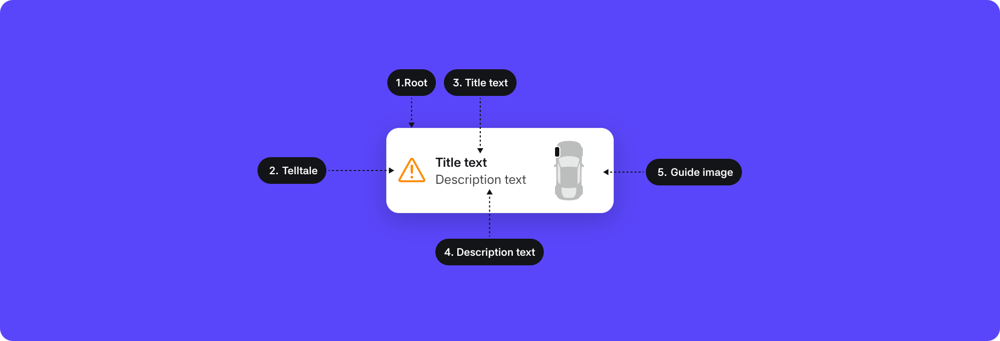
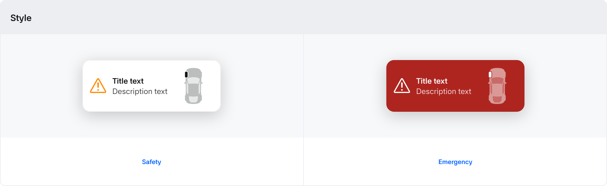
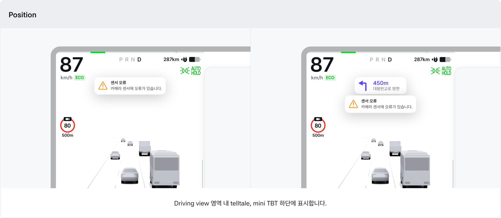

<!-- 원문: https://document.pleos.ai/docs/connect/guide/docs-design/components/notification/vehicle-notification -->
<!-- 가져온 날짜: 2026-11-12. 원문이 바뀌었을 수 있으니 중요한 결정 전에는 원문을 확인할 것. -->
<!-- 이 페이지는 원문 사이트의 사이드바·이전/다음 네비게이션에 노출되지 않습니다. URL로만 접근할 수 있습니다. -->

# Vehicle Notification

## Driving Notification

### Anatomy

**1. Root** : 컴포넌트를 감싸는 최상위 컨테이너 영역   **2. Telltale** : 알림과 관련된 telltale icon   **3. Title text** : Notification의 주요 메시지   **4. Description text** : 부가 설명   **5. Guide image** : 부가 이미지  

### Properties

### Position

